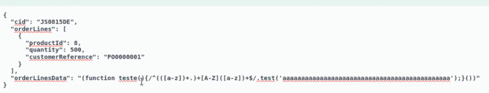

# Insecure Deserialization

- **Explicacao e teoria**
    - **Serialização  ⇒** processo de converter um objeto ou estrutura de dados (lista, dicionário ou instância de uma classe) em um formato como JSON, XML ou binário, para facilitar o armazenamento e transmissão.
        
        ```python
        import pickle
        import base64
        import os
        
        class Evil:
        	def __reduce__(self):
        	return (os.system, ("whoami",))
        	print(base64.b64encode(pickle.dumps(Evil())))
        ```
        
        - Podemos trocar o whoami para um comando de netcat, e realizar uma shell reversa
    - **Desserialização  ⇒** é o processo reverso, em que o formato serializado é convertido de volta ao objeto/estrutura de dados original.
        
        ```python
        import pickle
        import base64
        
        data = input("Insira os dados:")
        deserialized = pickle.loads(base64.b64decode(data))
        print(deserialized )
        ```
        
- **Guia Pratico**
    
    ### 1. **Observar atentamente cookies e headers na primeira resposta**
    
    Assim que você acessa a aplicação:
    
    - Veja os **cookies recebidos (Set-Cookie)**.
        - Se tiver algo como `user=`, `auth=`, `session=`, `payload=`, etc — **já suspeite**.
        - Cookies com **valores grandes, base64, estranhos ou incomuns** são os melhores candidatos.
    - Decode qualquer valor suspeito (talvez seja base64 mas o `=` do final esteja encodado em URL, ou tudo, entao tentar decodar antes, vai do contexto…):
    
    ```bash
    echo "VALOR" | base64 -d
    ```
    
    - Veja se aparece algo como:
        - `O:...` → PHP object
        - `a:...` → PHP array
        - `rO0AB` → Java serialized
        - JSON com `@class` ou `"type"`
    
    ---
    
    ### 2. **Capturar requisições com parâmetros que carregam objetos**
    
    Acompanhe ações que:
    
    - Enviam formulários
    - Salve dados (ex: carrinho, perfil, configs)
    - Faça upload/download
    - Use APIs
    
    **Ações:**
    
    - Inspecione **todos os parâmetros** GET/POST/JSON:
        - `data=`, `config=`, `user=`, `object=`, etc.
    - Decode novamente base64, ou JSON
    
    ---
    
    ### 3. **Tente modificar os dados serializados e veja se a aplicação reage**
    
    Use o mesmo valor modificado (sem payload ainda). Ex:
    
    - Mude `"admin"` para `"admin123"`
    - Altere `i:1` para `i:2`
    - Teste se retorna erro, muda a lógica ou responde diferente
    
    ---
    
    ### 4. **Buscar endpoints ocultos ou de debug com Gobuster**
    
    Se os passos acima não revelarem nada:
    
    **Ações:**
    
    ```bash
    gobuster dir -u http://target.com -w /usr/share/seclists/Discovery/Web-Content/api-endpoints.txt
    ```
    
    Buscar por:
    
    - `/api/`
    - `/debug/`
    - `/serialize`
    - `/config`
    - `/admin/backup`
    - `/logger`
    - `/store/`
    
    Alguns apps expõem pontos que **aceitam dados serializados diretamente**, especialmente em JSON ou XML.
    
    ---
    
    ### 5. **Interceptar requisições JSON, XML ou corpo POST (em APIs)**
    
    - Verifique se há estruturas complexas que representem objetos:
    
    ```json
    {
      "user": {
        "name": "admin",
        "roles": ["user"]
      }
    }
    ```
    
    - Veja se há campos como `"@class"` ou `"type"` (perigoso em Jackson, Fastjson, etc.)
    
    ---
    
    ### 6. **Testar payloads genéricos (sem RCE ainda)**
    
    - Tente injectar objetos falsos (`O:99:`, `a:3:`, etc)
    - Veja se a aplicação:
        - Quebra
        - Retorna erro
        - Loga algo diferente
        - Faz timeout
    
    ---
    
    ### 7. **Se a resposta for promissora, gere payload com ferramenta específica**
    
    - PHP: `PHPGGC`
    - Java: `ysoserial`
    - .NET: `ysoserial.net`
    
    Exemplo com PHPGGC:
    
    ```bash
    phpggc Monolog/RCE1 system 'id' | base64
    ```
    
    Envie esse valor no campo vulnerável e veja se **o comando é executado**.
    

---

- **SYCP:**
    - No video ele entra em um Swagger UI, e faz requisição pro site alterando o JSON, em que insere um while True para aplicar um DOS e crashar o site
        
        
