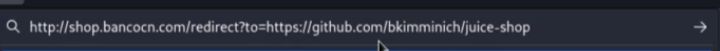
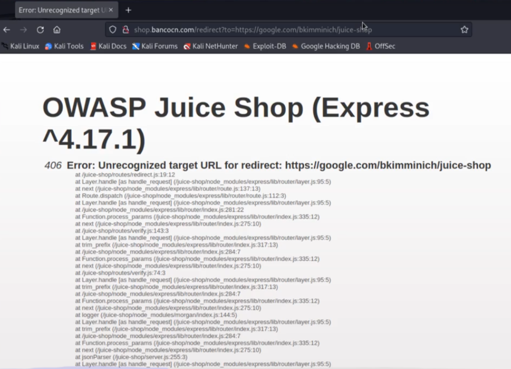

# Open Redirect

- Usar arjun para procurar hidden parameters e testar.. (ex: encontrou parametro `q`, testar `http:bla.com/?q=http://example.com`), normalmente essa vuln vai aparecer em botoes de links (como o de git no ex abaixo) e também ao clicar para logar/registrar de alguma pág do site (aparece pois assim que logarmos ele fará o redirect para onde estavamos)
- PARA TESTAR URL, USAR: **`http://example.com`**
- Através de um redirecionamento que o site possue, nós redirecionarmos a uma vítima para um endereço externo de nossa vontade.
- Ex: podemos enviar um link do site para uma pessoa, ela irá ver que a URL estará de fato correspondendo ao site original, porém devido a vulnerabilidade ela será redirecionada para o link que escolhemos

---

- No Juice Shop, ao clicarmos no GitHub, ele nos redireciona para o GitHub deles, e o link do redirecionamento é feito dessa maneira:
    
    
    
- Ou seja, podemos inserir um link depois do **to=**
    
    
    
- Nesse caso ele possue uma WhiteList, para apenas permitir redirecionar alguns links. Podemos fazer o bypass:
    1. Descobrir como está sendo feita a validação do link, pegamos o link original de redirecionamento: `http://shop.bancocn.com/redirect?to=https://github.com/bkimminich/juice-shop`
        1. Apagamos o juice-shop e damos enter e vemos se ele não permite e nos redireciona para a página da WhiteList(foto acima), assim saberemos primeiramente se ele está verificando se o juice-shop está no código
        2. inserir qualquer coisa no começo do link (depois do **=**), para ver se ele está validando se é um link http,etc. Nesse caso (deu certo no Lab do JuiceShop) notamos que podemos inserir qualquer coisa no inicio do redirecionamento que passaremos da WhiteList, pois contanto que tenha o link padrão no final do link não seremos barrados. Ou seja. colocamos o link de nosso desejo nesse começo e no final dele adicionamos um **/?** para que o link padrão vire apenas um parâmetro:`http://shop.bancocn.com/redirect?to=http://google.com/?https://github.com/bkimminich/juice-shop`
        3. Podemos adicionar um @ no final do link padrão e o link malicioso depois: [`http://shop.bancocn.com/redirect?to=https://github.com/bkimminich/juice-shop@](http://shop.bancocn.com/redirect?to=https://github.com/bkimminich/juice-shop@)google.com`
        4. Existem outras técnicas de bypass, procurar no google por : **open redirect payloads**
- Caso não exista a validação, podemos adicionar um javascript depois do **to=**  (XSS)
